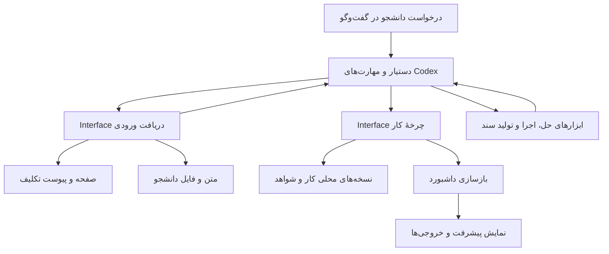

# طراحی Interfaceهای انجام تکلیف

این سند قرارداد جاری و تصمیم‌های فنی [تصمیم‌های محصول Q1 تا Q15](assignment-workflow-design.md) را توصیف می‌کند. APIها و Seamهای S1 تا S3 اکنون پیاده‌سازی و آزموده شده‌اند؛ S4 هنوز پذیرش دستی هدایت‌شده می‌خواهد. واژه‌های Module، Interface، Seam و Adapter مطابق مهارت `codebase-design` استفاده شده‌اند.

## شکل کلی

یک Module به نام `work` مسئول چرخهٔ انجام تکلیف است: ایجاد کار انتخاب‌شده، ذخیره و ادامه، حفظ نسخه‌ها، ثبت سؤال‌های باز، اعتبار بررسی‌ها و آماده‌کردن خروجی برای بررسی دانشجو. دستیار Codex متن را می‌خواند، حل می‌کند و ابزارها را اجرا می‌کند؛ `work` این فعالیت‌ها را انجام‌شده فرض نمی‌کند و نتیجه و شواهدشان را ثبت و کنترل می‌کند.



انتخاب و درخواست کار در گفت‌وگو انجام می‌شود. داشبورد یک نمایش محلی است و اجرای هوش مصنوعی یا فرایند پس‌زمینه ایجاد نمی‌کند.

## Moduleها و مسئولیت آن‌ها

| Module | Interface قابل مشاهده | Implementation پنهان‌شده |
|---|---|---|
| `work` جدید | شروع، خواندن، ذخیره، تطبیق ورودی، آماده‌سازی خروجی و فهرست کارها | شناسهٔ پایدار، نسخه‌ها، اعتبار بررسی‌ها، قواعد وضعیت، نوشتن پایدار فایل‌ها |
| `intake` جدید | تبدیل ورودی سایت یا دانشجو به یک دریافت ثبت‌شده | انتخاب محتوای صفحه، پیوست‌ها، منشأ، تشخیص ناقص‌بودن دریافت |
| `dashboard` موجود | ساخت HTML از اطلاعات درس و خلاصهٔ کارها | چیدمان، نمایش وضعیت‌ها، لینک خروجی و تازگی اطلاعات |
| `api` موجود | نام‌های عمومی زیر، مطابق الگوی فعلی پروژه | تبدیل ورودی/خروجی و اتصال به Moduleها؛ قواعد انجام تکلیف اینجا تکرار نمی‌شوند |
| مهارت‌های موجود | راهنمای دستیار برای استفاده از Interfaceها | انتخاب روش حل، استخراج متن فایل، ابزار تخصصی، تولید سند و بررسی معنایی |

Module `tracker` همچنان اطلاعات ثبت‌شده در سایت را نگه می‌دارد. وضعیت `draft` سایت و وضعیت پیشرفت پاسخ دو مفهوم جدا هستند. ردیف تکلیف در سایت و کار محلی با شناسه مرتبط می‌شوند؛ وضعیت پیشرفت به ستون وضعیت تحویل اضافه نمی‌شود.

## Seam اصلی: چرخهٔ انجام تکلیف

مهارت و آزمون هر دو از نام‌های عمومی در `cwtrack.api` استفاده می‌کنند. Interface عملیات چرخهٔ کار و گروه را نگه می‌دارد؛ برای هر تغییر کوچک مانند افزودن یک سؤال یا منبع، عملیات عمومی تازه ساخته نمی‌شود.

```python
work_start(request, *, data=None, work=None) -> StartResult
work_get(work_id, *, revision=None, data=None, work=None) -> WorkView
work_save(work_id, progress, *, expected_revision, data=None, work=None) -> SaveResult
work_sync(work_id, received_input, *, expected_revision, data=None, work=None) -> SyncResult
work_finish(work_id, delivery, *, expected_revision, data=None, work=None) -> FinishResult
work_list(*, selection=None, data=None, work=None) -> list[WorkView]
work_group_start(requests, *, data=None, work=None) -> WorkGroup
work_group_get(group_id, *, data=None, work=None) -> WorkGroup
collect_assignment(source, *, data=None, home=None, client=None, ...) -> IntakeResult
```

`data` و `work` طبق قرارداد مسیرهای فعلی پروژه حل می‌شوند. ورودی دستی برای شروع و خواندن کار به فروشگاه تکالیف سامانه نیاز ندارد؛ انتخاب از سامانه به فروشگاه قابل خواندن نیاز دارد. فقط `collect_assignment` شبکه می‌زند؛ Login و captcha وضعیت برمی‌گردانند و می‌توان Client آزمون را تزریق کرد. دیگر عملیات چاپ، پرسش تعاملی یا مرورگر ندارند. ذخیرهٔ فایل اثر صریح عملیات نوشتن است؛ خواندن فهرست یا داشبورد حل را شروع نمی‌کند.

| عملیات | رفتار و ترتیب لازم |
|---|---|
| `work_start` | ورودی `manual` یا `received` را ثبت می‌کند. کار سایت با ترکیب درس و `cmid` یکتا است؛ شروع تکراری `exists` می‌دهد و در صورت تفاوت دریافت، `input_changed` را گزارش می‌کند. ورودی دستی هر بار شناسهٔ مستقل می‌گیرد. اولویت اختیاری در ورودی ثبت می‌شود. |
| `work_get` | آخرین وضعیت یا نسخهٔ مشخص را همراه متن و منشأ، مسیر پوشه و فضای کاری، پیوست‌ها، سؤال‌ها، الزام‌ها، منابع، شواهد، خروجی‌ها و دو اثرانگشت محتوا برمی‌گرداند. |
| `work_save` | یک نسخهٔ پیشرفت را با بخش‌های پاسخ، سؤال‌های باز، منابع، الزام‌ها، بررسی‌ها و محدودیت‌ها اضافه می‌کند؛ نسخهٔ قبلی حذف نمی‌شود. شمارهٔ نسخهٔ مبنا اجباری است. |
| `work_sync` | دریافت تازه را با ورودی فعلی تطبیق می‌دهد. تغییر متن، عنوان، هویت درس/فعالیت یا hash پیوست، `needs_reassessment` را روشن می‌کند؛ تغییر صرفاً مهلت یا URL، پاسخ را بی‌اعتبار نمی‌کند. ورودی بدون متن و پیوست با `needs_input` رد می‌شود تا دریافت ناقص محتوای قبلی را حذف نکند. |
| `work_finish` | فایل‌های واقعی را با نام، نقش و SHA-256 در تاریخچه کپی می‌کند. نبود فایل/نقش، یادداشت، پاسخ سؤال یا بررسی موفقِ هم‌بسته با اثرانگشت ورودی، پاسخ و hash فایل‌های لازم، `needs_completion` می‌دهد. آمادگی فقط با الزام و شواهد کافی ثبت می‌شود. مسیر آپلود یا تغییر وضعیت تحویل سایت ندارد. |
| `work_list` | کارهای ذخیره‌شده را می‌خواند؛ بدون انتخاب بر اساس اولویت و سپس مهلت مرتب می‌کند. با `selection`، شناسه‌ها را به ترتیب صریح ورودی برمی‌گرداند. فهرست‌خوانی کار جدید نمی‌سازد. |
| `work_group_start` | فهرست صریح ورودی‌های دریافت‌شده را با تقدم اولویت و سپس مهلت شروع می‌کند؛ عضویت و ترتیب در manifest گروه ذخیره می‌شوند و خطای یک عضو بقیه را حذف نمی‌کند. |
| `work_group_get` | همان اعضای manifest را با آخرین وضعیت هر کار می‌خواند؛ تکالیف تازه به گروه قبلی اضافه نمی‌شوند. |

انتخاب گروهی پیش از شروع به فهرست صریح `ReceivedInput` تبدیل می‌شود؛ همین فهرست ذخیره می‌شود تا «تکالیف این هفته» پس از وقفه بی‌صدا به گروه دیگری تبدیل نشود. اولویت عددی بالاتر مقدم است، سپس مهلت زودتر و در تساوی ترتیب اولیه حفظ می‌شود. نتیجهٔ شروع گروهی موفقیت و خطای هر عضو را جدا نشان می‌دهد؛ شکست یک عضو باعث حذف کارهای ثبت‌شدهٔ دیگر نمی‌شود.

### داده‌های Interface

قرارداد فعلی از دیکشنری‌های محدود و اعتبارسنجی‌شده استفاده می‌کند و `api` مقادیر قابل تبدیل به JSON برمی‌گرداند. از دیکشنری فرمان عمومی با عملیات نامحدود استفاده نمی‌شود.

| داده | محتوای ضروری |
|---|---|
| `StartRequest` | `{"manual": ...}` یا `{"received": ...}`؛ منبع دستی یا ورودی نرمال‌شدهٔ سایت، همراه اولویت اختیاری |
| `WorkView` | شناسه، شمارهٔ نسخه، مرحله، زمان، منشأ و متن، مسیر پوشه/workspace، پیوست‌های immutable، بخش‌ها، منابع، الزام‌ها، سؤال‌ها، بررسی‌ها، اثرانگشت‌ها و خروجی‌ها |
| `Progress` | مرحله به‌جز «آماده»، بخش‌های پاسخ، سؤال‌ها، منابع، الزام‌های تحویل و روش بررسی، شواهدی که به اثرانگشت ورودی و پاسخ گره خورده‌اند، و محدودیت‌ها |
| `ReceivedInput` | منشأ سایت/دانشجو، متن و مشخصات تکلیف، مهلت و URL در صورت وجود، پیوست‌های محلی و منشأ؛ فایل غیرمتنی به خودی خود استخراج‌شده محسوب نمی‌شود |
| `CheckEvidence` | `requirement_id`، روش، نتیجهٔ `pass`/`fail`/`not_run`، توضیح، دو اثرانگشت ورودی/پاسخ، و نقش/hash فایل‌هایی که بررسی شده‌اند |
| `Delivery` | فایل‌های واقعی و نقش هرکدام، یادداشت تحویل و محدودیت‌ها؛ فایل‌ها با hash در تاریخچهٔ تغییرناپذیر کپی می‌شوند |
| `WorkGroup` | `group_id` ثابت و اعضای صریح با ترتیب/اولویت؛ هر بار خواندن، آخرین وضعیت همان کارها را می‌دهد |

شمارهٔ ثبت برای جلوگیری از ازبین‌رفتن تغییرات هم‌زمان است. اثرانگشت محتوا برای تعیین اعتبار بررسی‌هاست: ثبت یک یادداشت تازه، بررسیِ پاسخ بدون تغییر را بی‌اعتبار نمی‌کند، اما تغییر پاسخ یا ورودی مرتبط، آن بررسی را از اعتبار می‌اندازد. پاسخ‌های قبلی هنگام اصلاح حفظ می‌شوند.

### قواعد وضعیت و آمادگی

- کار با «آمادهٔ شروع» ایجاد می‌شود. نبود متن خوانده‌شده اجازهٔ تولید حل معتبر نمی‌دهد؛ دریافت متن یا ثبت سؤال برای تأمین آن در پیشرفت منعکس می‌شود.
- ثبت فعالیت آن را «در حال انجام» و شروع کنترل خروجی آن را «در حال بررسی» می‌کند. سؤال منتظر پاسخ و نیاز به بازبینی، نشان‌های مستقل‌اند و مانع کار روی بخش‌های مستقل نیستند.
- `work_save` نمی‌تواند مستقیماً وضعیت آماده ایجاد کند. تغییر پاسخ اثرانگشت آن را عوض می‌کند؛ شواهد قبلی به محتوای جدید نمی‌خورند.
- `work_finish` فایل‌های غیرخالی واقعی را کپی می‌کند، نقش‌های لازم را با الزام‌ها تطبیق می‌دهد و سؤال‌های باز و شواهد بررسی را می‌سنجد. فایل نمونه و قالب استاد را caller رعایت می‌کند؛ اعتبار علمی محتوا با ابزار عمومی به‌طور مستقل اثبات نمی‌شود.
- الزام‌ها و برنامهٔ بررسی پس از خواندن سؤال ثبت می‌شوند؛ آماده‌سازی با فهرست الزام خالی یا بدون شواهد هر الزام ممکن نیست. اگر الزام تغییر کند، شواهد لازم برای الزام‌های جاری باید ثبت شوند.
- برای هر الزام، شواهد `pass` با روش ثبت‌شده در الزام، توضیح، اثرانگشت ورودی و پاسخ جاری، و hash فایل‌های خروجی با نقش‌های لازم ثبت می‌شود. فایل log به‌تنهایی اثبات درستی علمی نیست: Module صحت ریاضی، کفایت استدلال یا کیفیت مقاله را مستقل تضمین نمی‌کند؛ بررسی معنایی توسط دستیار و ابزارهای متناسب انجام می‌شود و روش و محدودیت آن ثبت می‌شوند.
- فقدان دادهٔ لازم، ابزار رندر، امکان اجرای کد یا بررسی الزامی به نتیجهٔ «نیازمند تکمیل» با دلیل مشخص منجر می‌شود. فایل ناقص می‌تواند حفظ شود؛ به‌عنوان خروجی آماده برچسب نمی‌خورد.
- در تغییر صورت سؤال، ارتباط هر بخش پاسخ با سؤال/منبع مبنای تشخیص تأثیر است. اگر این ارتباط برای محدودکردن دامنهٔ اثر کافی نباشد، همهٔ بخش‌های وابسته به دریافت قبلی نیازمند بازبینی می‌شوند؛ تشخیص معنایی توسط دستیار با دلیل ثبت می‌شود.

### حالت‌های قابل انتظار و خطا

خروجی عملیات نوشتن یک شکل ثابت دارد: `status`، شناسه/شمارهٔ ثبت در صورت وجود، اطلاعات کار یا جزئیات کمبود، و نتیجهٔ به‌روزرسانی داشبورد. وضعیت چرخهٔ کار در فیلد `stage` جدا از `status` عملیات است.

| نتیجه | معنا |
|---|---|
| `ok` / `exists` | ثبت موفق / بازگرداندن کار موجود بدون بازنویسی |
| `needs_input` | متن، داده یا رفع ابهام لازم است؛ موارد مشخص بازگردانده می‌شوند |
| `needs_completion` | فایل یا کنترل کافی برای آماده‌بودن وجود ندارد؛ کار و پیشرفت محفوظ‌اند |
| `conflict` | `expected_revision` قدیمی است؛ ثبت انجام نشده و آخرین شماره برای خواندن و تطبیق ارائه می‌شود |
| `busy` | نویسندهٔ زندهٔ دیگری همان کار را ثبت می‌کند؛ caller پس از خواندن مجدد می‌تواند ثبت را تکرار کند |
| `not_found` / `invalid_input` | شناسه پیدا نشد / ورودی با قرارداد سازگار نیست؛ تغییر جزئی انجام نمی‌شود |

خرابی ذخیره‌سازی یا خطای I/O به‌صورت `CwError` با مسیر و دلیل گزارش می‌شود؛ به نتیجهٔ خالی یا موفقیت تبدیل نمی‌شود. نوشتن نسخهٔ ناقص، آخرین نسخهٔ معتبر را جایگزین نمی‌کند. شکست تولید داشبورد بعد از ثبت موفق، به‌صورت هشدار جدا همراه `saved_revision` گزارش می‌شود تا caller ثبت را تکرار نکند.

نتیجهٔ `needs_completion` در `work_finish` می‌تواند ثبت موفقِ خروجی ناقص و دلایل باقی‌مانده باشد؛ در این حالت `revision` صریح است و مرحلهٔ ذخیره‌شده «نیازمند تکمیل» است. در مقابل، `conflict`، `busy` و `invalid_input` چیزی ثبت نمی‌کنند.

## Seam دریافت ورودی

```python
collect_assignment(source, *, data=None, home=None, client=None,
                   user=None, password=None, captcha=None, base=None) -> IntakeResult
```

`source` یکی از دو ورودی مشخص است: `{"site": {"cmid": ...}}` یا `{"manual": ...}`. خروجی `input` نرمال‌شده همراه وضعیت دریافت است. این عملیات کار ایجاد یا حل نمی‌کند؛ ورودی به `work_start` یا `work_sync` داده می‌شود. دریافت دستی متن را از `.txt`, `.md`, `.csv` می‌خواند و بقیهٔ فایل‌ها را به‌عنوان پیوست نگه می‌دارد.

برای سایت، `cmid` باید در فروشگاه محلی دیده شده باشد. ورود از قرارداد `needs_credentials` / `captcha_required` / `captcha_rejected` پیروی می‌کند؛ اطلاعات ورود از محیط یا آرگومان API گرفته می‌شوند و در دادهٔ کار ذخیره نمی‌شوند. صفحهٔ جزئیات و پیوست‌های مسیر introattachment دریافت می‌شوند. Client واردشده Seam آزمون است؛ Adapter آزمون HTML و فایل ساختگی می‌دهد و تست‌ها بدون حساب و شبکه‌اند.

`fetch.py` همچنان فقط فهرست تکالیف را دریافت می‌کند؛ جزئیات در Seam جدید `intake` دریافت می‌شوند. آزمون ساختگی مسیر دریافت را ثابت می‌کند، اما دسترس‌پذیری همهٔ صفحات زنده یا انواع فایل سامانه را اثبات نمی‌کند.

دریافت فایل از پردازش معنایی آن جداست. ابزارهای سند، PDF، تصویر و ارائه در Codex متن را استخراج و بررسی می‌کنند و نتیجه از `work_save` ثبت می‌شود؛ نبود ابزار با `needs_input` یا `needs_completion` همراه دلیل گزارش می‌شود. منابع وب با عنوان و ارجاع در `sources` ثبت می‌شوند؛ Module دریافت ورودی یک موتور جست‌وجوی عمومی نیست.

## وابستگی‌ها و Adapterها

| وابستگی | نوع | انتخاب طراحی |
|---|---|---|
| تشخیص تغییر محتوا، قواعد وضعیت و مرتب‌سازی | In-process | داخل `work`؛ بدون port یا Adapter اضافی |
| فایل‌های محلی | Local-substitutable | همان filesystem واقعی در پوشهٔ موقت آزمون؛ Repository فرضی و Adapter حافظه‌ای ساخته نمی‌شود |
| سامانهٔ دانشگاه | True external | Adapter واقعی مبتنی بر Client و Adapter آزمون با پاسخ‌های پاک‌شده؛ شبکه در Seam دریافت ورودی تزریق می‌شود |
| ابزارهای حل و تولید فایل | ابزارهای خارج از فرایند پایتون | دستیار آن‌ها را اجرا می‌کند و شواهد را ثبت می‌کند؛ Interface عمومی «LLM provider» یا «solver plugin» در نسخهٔ اول ساخته نمی‌شود |

زمان ثبت از یک clock تزریق‌شده در Implementation و ریشهٔ فایل‌ها از مسیر صریح می‌آید؛ caller زمان و هویت نسخه را جعل یا محاسبه نمی‌کند. Interface فقط پارامترهایی را می‌گیرد که caller برای معنای عملیات لازم دارد.

## ذخیره، نسخه‌ها و سازگاری

کار در `work/<work_id>/` به‌صورت فایل‌های JSON نسخه‌بندی‌شده نگهداری می‌شود. هر snapshot و فایل ورودی/خروجی در نسخه یا تحویل مختص به خود کپی می‌شود و با تغییر مبدأ عوض نمی‌شود. هر snapshot ابتدا در فایل موقت نوشته و با تعویض اتمی ثبت می‌شود. نوشتن هم‌زمان با قفل سیستم‌عامل و بررسی `expected_revision` مدیریت می‌شود. API در WorkView مسیر `folder` و `workspace` را محاسبه می‌کند؛ خواندن، پوشهٔ workspace را ایجاد نمی‌کند.

برای این پیاده‌سازی، پایگاه داده یا صف وظایف اضافه نمی‌شود. Layout داخلی فایل‌ها Interface نیست و آزمون رفتار چرخهٔ کار نباید به آن وابسته شود. شناسهٔ سایت/درس/فعالیت فقط ارتباط با تکلیف را نگه می‌دارد؛ هویت کار دستی نیز مستقل از عنوان است.

`make_brief` و پوشه‌های موجود بدون تغییر ناخواسته کار می‌کنند و برای جریان brief-only قدیمی باقی می‌مانند. ورود خودکار فایل‌های بریف قدیمی به snapshot جدید هنوز پیاده نشده است؛ دو جریان در راهنمای `university-assignment` پشتیبانی می‌شوند، اما مهاجرت داده انجام نمی‌شود.

## اتصال به داشبورد و مهارت‌ها

- `api.build_dashboard` snapshotهای خوانده‌شده از Module `work` را به `dashboard.build` می‌دهد. Renderer داده می‌گیرد و HTML برمی‌گرداند؛ فایل‌های کار را مستقیماً تفسیر نمی‌کند. `api.work_list` همان کارها را برای caller با مرتب‌سازی اولویت و مهلت عرضه می‌کند.
- امضای عمومی موجود به‌صورت سازگار `build_dashboard(data=None, out=None, *, work=None) -> Path` گسترش می‌یابد تا مسیر سفارشی کارها نیز قابل نمایش باشد.
- نبود فروشگاه CW در کار دستی مانع نمایش بخش انجام تکالیف نمی‌شود؛ بخش اطلاعات سامانه صریحاً «داده در دسترس نیست» نشان می‌دهد. قرارداد فعلی `status()` دربارهٔ فروشگاه گمشده حفظ می‌شود و صفر تکلیف گزارش نمی‌شود.
- پس از ثبت مراحل مهم، هماهنگ‌کننده در `api` داشبورد را بازسازی می‌کند. شکست بازسازی دادهٔ کار را برنمی‌گرداند و امکان فراخوانی مجدد `build_dashboard` وجود دارد.
- زمان آخرین ثبت کار، زمان آخرین دریافت از سایت و زمان ساخت صفحه جدا هستند. «در حال انجام» مرحلهٔ آخر ثبت‌شده است و به معنای زنده‌بودن فرایند نیست.
- `sharif-cw` انتخاب و دریافت سؤال را هدایت می‌کند؛ `university-assignment` دریافت ثبت‌شده را می‌خواند، برنامهٔ بررسی متناسب می‌سازد، پیشرفت را ذخیره و خروجی را برای `work_finish` ارائه می‌کند. راهنمای ادامه از اطلاعات ذخیره‌شده خوانده می‌شود؛ حافظهٔ گفت‌وگو تنها محل نگهداری کار نیست.
- هر دو مهارت در `.agents/skills/` به قرارداد جدید وصل شده‌اند. ادعای پیشین دربارهٔ ناتوانی سامانه در ارائهٔ متن سؤال دیگر راهنمای اجرایی نیست؛ دریافت زنده همچنان به آزمون و ورود کاربر نیاز دارد.

## پوشش انواع تکلیف

انواع تکلیف انتخاب راهنمای حل، فایل خروجی و برنامهٔ بررسی را تغییر می‌دهند؛ چرخهٔ ذخیره و نسخه‌سازی یکی است. یک Interface یا کلاس مستقل برای هر نوع ساخته نمی‌شود. تکلیف ترکیبی می‌تواند چند نوع فایل و چند گروه بررسی داشته باشد.

| نوع | نمونهٔ کنترل لازم علاوه بر الزام‌های خاص استاد |
|---|---|
| حل مسئله | محاسبه، واحدها، جایگذاری یا آزمون حالت حدی |
| اثبات | فرض‌ها، پیوستگی استدلال و حالت‌های مرزی |
| کدنویسی | اجرای واقعی، رفتار مورد انتظار، راهنمای اجرا و وابستگی‌ها |
| گزارش آزمایشگاه | منشأ دادهٔ واقعی، محاسبه و تحلیل خطا، نمایش سند |
| مقاله و مرور منابع | منابع بازیابی‌شده، ارتباط ادعا و منبع، ساختار/دامنه و نمایش سند |
| ترجمه | پوشش متن مبدأ، اصطلاحات و ابهام‌ها، نمایش سند |
| طراحی | الزام‌ها و فرض‌ها، محاسبات/منابع لازم و فایل طراحی متناسب |
| ارائه | ساختار و زمان‌بندی طبق سؤال، نمایش اسلاید و خروجی‌های PPTX/PDF |

## وضعیت Seamهای آزمون

Seamهای S1 تا S3 با آزمون رفتار عمومی در `tests/test_work.py` پیاده شده‌اند. هیچ آزمونی به شبکه یا حساب دانشجو وصل نمی‌شود. S4 سناریوی پذیرش هدایت‌شدهٔ Codex است.

| Seam | چه چیزی را می‌گیرد | چه چیزی را اثبات نمی‌کند |
|---|---|---|
| S1: `api.work_*` و filesystem موقت | ادامه در پردازش تازه، نسخه‌بندی، گروه ثابت و ترتیب، اولویت و فهرست‌خوانی، تغییر مهلت/متن، شواهد جاری، conflict و امتناع از آمادگی ناقص | صحت علمی حل یا کیفیت واقعی ارائه |
| S2: `collect_assignment` با Adapter ساختگی و فایل ورودی | متن صفحه، پیوست، اعتبار cmid، متن دستی، حفظ پیوست و وضعیت ورودی ناقص | سازگاری با همهٔ صفحات زنده یا استخراج PDF/OCR |
| S3: `api.build_dashboard` با کار ذخیره‌شده | نمایش پیشرفت، سؤال، آخرین ثبت و فایل خروجی؛ کار دستی بدون فروشگاه؛ بازسازی پس از ثبت | کیفیت ظاهری همهٔ اندازه‌های صفحه؛ بازبینی بصری مکمل است |
| S4: مسیر مهارت تا فایل خروجی برای هر نوع | دریافت، حل، ثبت بررسی، تولید و بازبینی فایل‌های واقعی | تضمین حل همهٔ پرسش‌های دانشگاهی یا اجرای مدل داخل pytest |

S1 تا S3 آزمون رفتاری و بدون شبکه هستند. S4 هنوز اجرا نشده؛ آزمون خودکار قرارداد مهارت مکمل آن است و جای اجرای واقعی سناریو را نمی‌گیرد. آزمون‌های قبلیِ نامرتبط حفظ می‌شوند؛ آزمون تازه‌ای برای جزئیات خصوصی ذخیره‌سازی روی آزمون Interface انباشته نمی‌شود.

## انتخاب بین شکل‌های جایگزین

| گزینه | ارزیابی |
|---|---|
| افزودن توابع مستقل برای هر فایل، سؤال، مرحله و نوع تکلیف | Interface بزرگ می‌شود و caller باید ترتیب ذخیره، بی‌اعتبارشدن بررسی و نسخه‌سازی را بداند؛ Depth کم است. |
| یک `solve()` که دریافت، حل و رندر را در پایتون پنهان کند | با اجرای حل در Codex ناسازگار است؛ توقف، ادامه و نبود ابزار را پشت ادعای اجرای واحد پنهان می‌کند. |
| پنج عملیات روی یک کار پایدار، دو عملیات گروه و `work_list` همراه Seam دریافت ورودی | انتخاب جاری؛ قواعد نسخه و آمادگی در یک محل‌اند و مهارت و داشبورد قرارداد مشترک دارند. |

آزمون حذف: اگر `work` حذف شود، قواعد نسخه‌ها، ادامه، بازبینی و آمادگی باید در هر مهارت و مسیر داشبورد تکرار شوند؛ بنابراین Module پیچیدگی واقعی را پنهان می‌کند. اگر یک wrapper فقط تابع را با همان ورودی به Module بعدی می‌فرستد و قرارداد عمومی لازم ندارد، در Implementation خصوصی می‌ماند.

## برش‌های پیاده‌سازی و پذیرش باقی‌مانده

S1 تا S3 پیاده شده‌اند و با `py -3.14 -m pytest -q` بررسی می‌شوند. ادامهٔ پذیرش: اجرای S4 برای همهٔ انواع دامنه، بررسی ظاهری داشبورد در اندازه‌های گوناگون، ارزیابی صفحه‌ها و انواع فایل واقعی سامانه، و پشتیبانی بهتر از تبدیل/اعتبارسنجی پیوست‌های غیرمتنی. پوشش نسخهٔ اول برای همهٔ انواع دامنه با کمک مهارت Codex فراهم است؛ Python API یک حل‌کنندهٔ خودکار نیست.

هر تغییر دیگر در همان Seamهای رفتاری می‌ماند؛ آزمون‌های جزئیات خصوصی ذخیره‌سازی به قرارداد عمومی اضافه نمی‌شوند.
