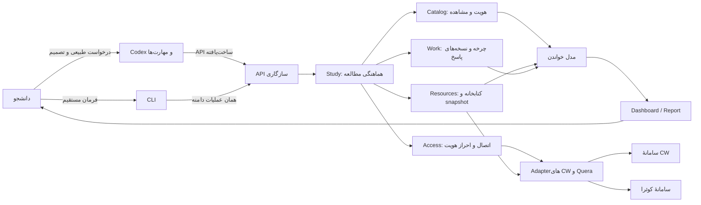
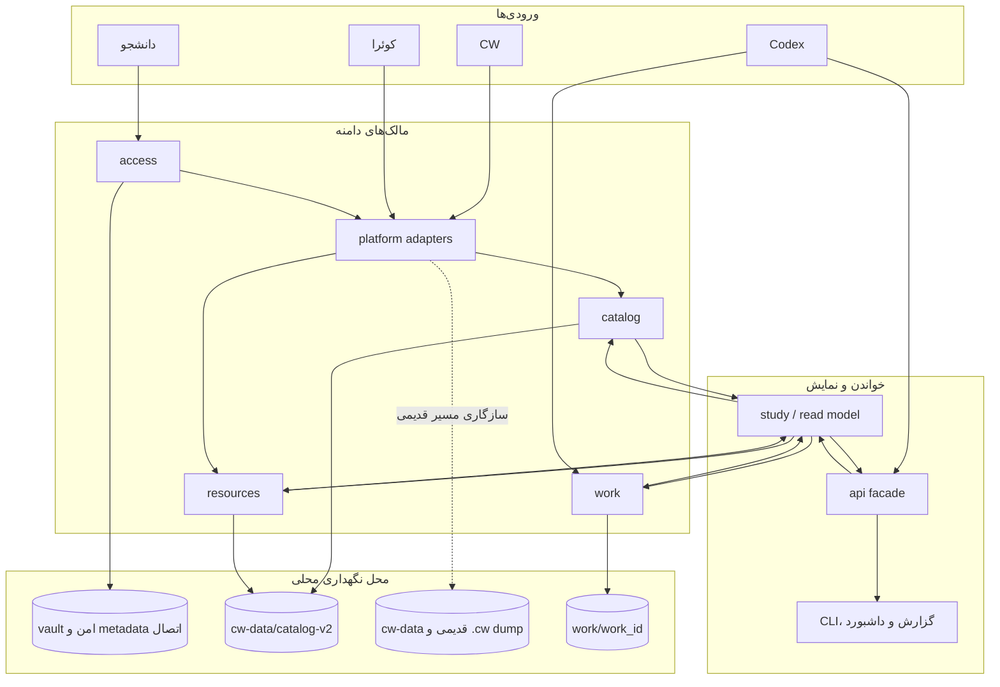
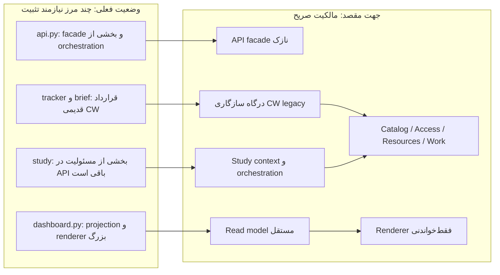

# معماری ماژولار `cwtrack`

این سند نقشهٔ وضعیت فعلی و جهت معماری است. هدف از ماژولار بودن، کم‌کردن تعداد خطوط یا ساختن پوشه‌های بیشتر نیست؛ هر ماژول باید یک مفهوم را مالک باشد، قرارداد پایدار داشته باشد و تغییرات در همان مرز بمانند. داستان‌ها و مسئولیت actorها در [داستان‌های کاربر و روندهای محصول](product-workflows.md) تعریف شده‌اند.

## نمای کلان



فلش‌ها جهت وابستگی هدف را نشان می‌دهند، نه تضمین کامل وضعیت importهای کنونی. UI و مدل خواندن نباید تصمیم دامنه، شبکه یا تغییر داده را مالک شوند. مهارت Codex هماهنگ‌کنندهٔ رفتار AI است، نه ماژول اجرایی برنامه.

## نقشهٔ مالکیت داده و ذخیره‌سازی



مالکیت یک داده از محل نمایش آن جداست: فایل داشبورد نسخهٔ مرجع تکلیف نیست؛ `work` مالک تاریخچهٔ پاسخ است و `catalog` مالک مشاهده و نگاشت سامانه‌هاست.

## تصویر وضعیت فعلی و جهت مقصد



این تصویر مقصد refactor است، نه ادعای وضعیت پیاده‌سازی‌شده. ترتیب اجرایی پیشنهادی در بخش «مسیر ماژولار کردن» آمده است.

## مرز ماژول‌ها

| ماژول | مسئولیت واحد و قرارداد | داده‌ای که مالک است | خارج از مسئولیت |
|---|---|---|---|
| `api` | ورودی پایدار برای Codex و callerهای بیرونی؛ تبدیل درخواست به عملیات و بازگرداندن مقدار ساخت‌یافته | هیچ دامنهٔ مستقلی ندارد | parser، قواعد تمام دامنه‌ها، چاپ، prompt تعاملی، رندر جزئی |
| `cli` | parsing آرگومان، prompt انسانی، نمایش پاسخ و خروج با کد مناسب | ورودی موقت ترمینال | قواعد کسب‌وکار، اجرای مستقیم شبکه، ساخت مجدد status |
| `study` | هماهنگی مشاهده/تازه‌سازی، انتخاب کار، آماده‌سازی `WorkPacket` و مدل مطالعهٔ مشترک | عملیات مطالعه و هماهنگی | تفسیر HTML، نگهداری راز یا منطق نسخهٔ پاسخ |
| `catalog` | هویت اتصال/کلاس/تکلیف، observation، coverage، پیوند offering، وضعیت نیم‌سال و رابطهٔ تکلیف | `catalog-v2` و projectionهای آن | credential، محتوای پاسخ و snapshot فایل |
| `access` | اتصال حساب، چرخهٔ احراز، challenge، انقضا و رازها از طریق vault | metadata اتصال و ارجاع امن راز | قواعد تجمیع درس یا تحویل پاسخ |
| `platforms/*` | تبدیل قرارداد داخلی به درخواست/پاسخ CW یا کوئرا؛ parser و capabilityهای مخصوص همان سایت | fixture/capture خام در مرز Adapter در صورت نیاز | گروه‌بندی نیم‌سال، چرخهٔ پاسخ و تصمیم عمومی محصول |
| `resources` | ثبت منبع، binding، دریافت/خواندن پشتیبانی‌شده، snapshot و نسخهٔ استفاده‌شده | کتابخانهٔ منابع و محتوا | تضمین درستی علمی یا ادعای استفاده بدون خواندن |
| `work` | چرخهٔ مستقل هر تکلیف، ورودی، پاسخ، فایل، نسخه، الزام‌ها، بررسی و خروجی | `work/<work_id>/` | دریافت مستقیم شبکه، ورود، انتخاب تکلیف‌های سامانه |
| `intake` | گرفتن ورودی قابل‌حل از پلتفرم و تبدیل آن به قرارداد ورودی کار | نتیجهٔ موقت intake | مالکیت چرخهٔ کار پس از شروع |
| `dashboard_projection` | تبدیل دادهٔ read model و legacy به ردیف‌های پایدار تکلیف، freshness و گروه درس | هیچ دادهٔ مرجع ندارد | HTML/CSS، شبکه، نوشتن یا انتخاب تکلیف |
| `dashboard` | رندر HTML از view-model و ساخت گروه/کارت‌های نمایشی | هیچ دادهٔ مرجع ندارد | شبکه، نوشتن، انتخاب تکلیف یا مالکیت داده |
| `report`, `brief`, `tracker` | سازگاری با گزارش‌ها و گردش قدیمی CW | قرارداد قدیمی تا زمان مهاجرت | منبع حقیقت موازی برای مدل چندسامانه‌ای آینده |
| `dates`, `classify`, `parse`, `match` | توابع/سرویس‌های کوچک با ورودی و خروجی روشن | دادهٔ پایدار ندارند | خواندن filesystem یا وضعیت سراسری پنهان |
| مهارت‌های Codex | تبدیل درخواست انسانی به عملیات API و انجام کار شناختی/تولیدی | دستورالعمل‌های گردش AI | دسترسی مستقل یا مستقیم به منبع حقیقت دورزنندهٔ API |

### قاعدهٔ تشخیص مالک

اگر دو بخش می‌توانند دربارهٔ یک واقعیت تصمیم متفاوت بگیرند، مالکیت شکسته است. نمونه‌ها:

- فقط `catalog` تصمیم می‌گیرد یک کلاس به کدام درسِ نیم‌سال وصل است؛ dashboard آن را دوباره حدس نمی‌زند.
- فقط Adapter مشخص می‌کند صفحهٔ سامانه چه داده‌ای مشاهده کرده؛ `study` پاسخ HTML را parse نمی‌کند.
- فقط `work` تعیین می‌کند پاسخ محلی با کدام نسخه و شواهد آمادهٔ بازبینی است؛ وضعیت ارسال را از سایت به آن تعمیم نمی‌دهد.
- منبع ثبت‌شده، محتوای دریافت‌شده و بخشِ واقعاً استفاده‌شده سه واقعیت جدا هستند؛ `resources` نگهداری می‌کند و `work` استفاده در پاسخ را ثبت می‌کند.

## وضعیت واقعی ماژول‌ها

مخزن ساختار ماژولی دارد، اما renderer و چند adapter قدیمی هنوز مرزهای بزرگی دارند. بعد از جداسازی جریان‌های CW قدیمی و bootstrap اتصال‌ها، `api.py` حدود ۶۵۰ خط wrapper و glue سازگاری دارد؛ `legacy_application.py` مالک جریان‌های قدیمی CW است، `access_application.py` عملیات اتصال را هماهنگ می‌کند و `platform_runtime.py` ساخت adapter و AccessManager را نگه می‌دارد. `dashboard.py` همچنان renderer بزرگ است؛ اندازه به‌تنهایی defect نیست، اما جداسازی مدل نمایش از HTML هنوز کامل نشده است.

| ناحیهٔ فعلی | وضعیت | دلیل و مقصد |
|---|---|---|
| `api.py` | façade عمومی سازگار با callerهای قدیمی | عملیات دامنه به applicationها delegate می‌شود. نام‌های خصوصی مورد استفادهٔ caller/test قدیمی به‌صورت alias یا injection seam نگه داشته شده‌اند؛ orchestration تازه در facade افزوده نشود. |
| `legacy_application.py` | مالک جریان‌های CW قدیمی و گزارش‌های سازگاری | store قدیمی، status/report, brief, ingest و refresh در این ماژول‌اند؛ قراردادها CW-only باقی می‌مانند. |
| `access_application.py` + `platform_runtime.py` | مدیریت اتصال و ساخت runtime adapterها | عملیات نام‌گذاری/اتصال از facade جداست؛ runtime manager و factoryها مستقل از CLI هستند. |
| `dashboard_projection.py` + `dashboard.py` | projection تکلیف و freshness از renderer جدا شده؛ renderer HTML تک‌صفحه‌ای را تولید می‌کند | طبقه‌بندی تکلیف، deadline، وضعیت تحویل و freshness در projection خالص‌اند؛ چیدمان گروه و کارت هنوز در renderer است و می‌تواند با آزمون برابری خروجی بیشتر جدا شود. |
| `catalog.py` + `tracker.py` | مدل جدید چندسامانه‌ای کنار store قدیمی CW | مرز سازگاری روشن شود؛ قابلیت جدید به tracker قدیمی وابسته نشود؛ مهاجرت فقط با قرارداد سازگاری و fixtureهای واقعی انجام شود. |
| `study.py` + applicationهای مطالعه | orchestration refresh/continue و آماده‌سازی به دو flow مستقل منتقل شده‌اند | `study_application` refresh و continuation را مالک است؛ `study_preparation` انتخاب صریح و آماده‌سازی تک/گروهی Work را هماهنگ می‌کند؛ `study_sources` منابع را بررسی می‌کند؛ `read_model` projection را می‌سازد. |
| `read_model.py` | projection خواندنی محلی از storeهای assignment, study, catalog, resources و work | فقط خواندن و ترکیب داده؛ dashboard و CLI آن را مصرف می‌کنند؛ هیچ HTTP یا تغییر دامنه ندارد. |
| `dashboard_projection.py` | view-model خالص از تکلیف‌های سامانه و legacy؛ deduplication، state، deadline و freshness | فقط projection؛ بدون HTML، I/O یا mutation. `dashboard.py` از خروجی آن برای رندر استفاده می‌کند. |
| `dashboard_application.py` | گردآوری read model و store قدیمی و تولید دو artifact محلی | مسیر و نوشتن فایل در application؛ قالب HTML در `dashboard.py` می‌ماند. |
| `study_intake.py` + `task_refs.py` | جمع‌آوری ورودی دستی/CW/کوئرا و اعتبارسنجی یک TaskRef یکتا | adapter API فقط وابستگی‌های filesystem، captcha و access را تزریق می‌کند. |
| `auth.py`, `client.py`, `access.py` | مسئولیت‌ها قابل تفکیک اما مرز challenge حساس | نگهداری secret و stateful continuation در `access`؛ HTTP در transport/client؛ پروتکل سایت در Adapter. جریان CAPTCHA باید یک state machine قابل‌آزمون باقی بماند. |
| `resources.py` + `resource_application.py` + `study_sources.py` | کتابخانهٔ منابع و ثبت snapshot owner دارند؛ جمع‌آوری/گزارش منبع درس در application جداست | `study_sources` منابع درس را فقط از کلاس انتخاب‌شده/پیوندخورده بررسی می‌کند و وضعیت coverage را گزارش می‌دهد؛ دانلود سایت در Adapter می‌ماند. |
| `work.py` | چرخهٔ نسبتاً منسجم و پرقواعد | حفظ به‌عنوان owner واحد؛ فقط در صورت seam روشن، اجزای persistence/validation استخراج شوند، نه به قیمت پخش چرخه در چند ماژول. |
| `cli.py` | adapter سازگاری برای فرمان‌های legacy | نگه‌داشتن رفتار `fetch/report/open/gaps/material/brief` بدون تغییر قرارداد. |
| `cli_domain.py` | dispatcher فرمان‌های چندسامانه‌ای `account/study/resource/relation/work` | prompt، انتخاب نام اتصال و دریافت JSON از فایل؛ فراخوانی فقط از public API؛ فرمان‌های CW قدیمی در `cli.py` سازگار می‌مانند. |
| `.agents/skills/*` | دو گردش مستقل Codex مستند هستند | عملیات API و قواعد انسانی بمانند؛ قرارداد خروجی و status با API و اسناد product sync شوند. |

## جهت وابستگی و ممنوعیت‌ها

قانون import پیشنهادی:

```text
cli ─┐
     ├──> application facade (api / study context) ──> domain owners
AI ──┘                                          ├──> catalog
                                                ├──> resources
                                                ├──> work
                                                └──> access ──> platform adapters
platform adapters ──> transport + parsing utilities
read model ──> domain read interfaces ──> dashboard/report renderer
```

- ماژول دامنه نباید `cli`, مهارت، `dashboard` یا یک فایل سطح بالاتر را import کند.
- `dashboard` و `report` نباید API نوشتن یا HTTP فراخوانی کنند.
- `work` نباید `study` یا Adapter پلتفرم را import کند؛ ورودی و dependency از قرارداد روشن تزریق شوند.
- Adapter سایت نباید به قواعد offering، lifecycle کار، مسیر جاری کاربر یا DOM داخلی dashboard وابسته باشد.
- filesystem، ساعت، HTTP، vault و content reader در constructor/context یا interface مشخص تزریق شوند؛ import-time side effect ممنوع.
- دادهٔ خام بیرونی در مرز Adapter اعتبارسنجی و به قرارداد داخلی تبدیل شود؛ قواعد دامنه روی مدل داخلی اجرا شوند.
- شکست با status/error ساخت‌یافته برگردد. API هرگز prompt/print/browser باز نکند؛ فقط CLI و Codex با کاربر تعامل دارند.

## قراردادهای معماری که باید حفظ شوند

1. یک offering از کلاس‌های سامانه مستقل است؛ نگاشت بدون تصمیم معتبر ساخته نمی‌شود.
2. هر مشاهده با زمان، اتصال، دامنه و coverage ذخیره می‌شود؛ نبود مشاهده، نبود تکلیف نیست.
3. هر تکلیف انتخاب‌شده یک work مستقل دارد؛ رابطهٔ تکلیف‌ها پاسخ‌ها را ادغام نمی‌کند.
4. ثبت منبع مساوی دریافت محتوا نیست؛ دریافت محتوا مساوی استفاده نیست.
5. آمادهٔ بازبینی دانشجو مساوی ارسال در سامانه نیست.
6. هر ادعای verification باید به ورودی/پاسخ و فایل واقعی بررسی‌شده متصل باشد.
7. نبود/فساد store به خطای قابل‌دیدن می‌انجامد، نه دادهٔ خالی پیش‌فرض.
8. credential هرگز در repo، dump، argv یا فایل متنی پروژه قرار نمی‌گیرد.

## مسیر ماژولار کردن

ترتیب به‌گونه‌ای است که قراردادها پیش از جابه‌جایی کد تثبیت شوند و مسیر قدیمی قطع نشود:

1. **تعریف سطح API:** فهرست عملیات پایدار، schema ورودی/خروجی، error/statusها، actor و مالک دامنه را از این سند و `product-workflows.md` به‌عنوان قرارداد مرجع مشخص کنید.
2. **تثبیت Context مطالعه:** `study_prepare` در `study_preparation.py`، `study_continue/challenges/refresh` در `study_application.py`، `collect_assignment` در `study_intake.py` و `course_sources` در `study_sources.py` قرار گرفتند؛ سنجش و ساده‌سازی وابستگی‌های مشترک ادامه دارد.
3. **جداکردن مدل خواندن از dashboard:** `StudyView` و `dashboard_projection.py` مدل خواندن و ردیف تکلیف/freshness را از HTML جدا کرده‌اند؛ ساخت گروه و کارت در renderer باقی است و با حفظ parity خروجی می‌تواند به projection منتقل شود.
4. **مرزبندی `api.py`:** هر عملیات به module owner منتقل و API به façade سازگار تبدیل شود؛ importهای public قدیمی تا مهاجرت callerها حفظ شوند.
5. **محصورکردن CW legacy:** مسیرهای `tracker`, `brief`, `materials_text`, `refresh` با adapter سازگاری مشخص؛ دادهٔ قدیمی حذف یا بازنویسی نشود مگر migration نسخه‌دار داشته باشد.
6. **یکسان‌سازی CLI:** همهٔ فرمان‌های مدیریت از public API عبور کنند و تعامل/انتخاب در CLI بماند.
7. **پذیرش actorها:** برای هر workflow، آفلاین و در صورت امکان پذیرش زنده، خطای واقعی، challenge، دریافت تکراری و از دسترس‌رفتن سایت به‌طور جدا ارزیابی شود.

هر برش اجرایی باید کوچک و برگشت‌پذیر باشد، مالکیت داده را جابه‌جا نکند، API عمومی را ناخواسته نشکند و وضعیت docs را همان تغییر به‌روز کند. این سند به‌تنهایی ادعای پیاده‌شدن refactor نیست.

## وضعیت اجرای دامنهٔ تأییدشده

فرمان‌های حوزه‌ای اکنون به `cli_domain.py` واگذار شده‌اند و `cli.py` adapter سازگاری مسیرهای legacy است. اتصال می‌تواند alias محلی بگیرد؛ فهرست امن alias، سامانه و origin را نشان می‌دهد و نام کاربری و شناسهٔ داخلی را در مسیر account افشا نمی‌کند. `study report` نمای مشترک را می‌خواند و `report/open/gaps` legacy CW باقی می‌مانند.

مرز API و مالکیت storeها هنوز به refactor کامل نرسیده است: CRUD منابع در `resource_application.py`، پیوندهای کاتالوگ در `catalog_application.py`، عملیات رکوردهای کار در `work_application.py`، intake در `study_intake.py`، بررسی منابع درس در `study_sources.py`، آماده‌سازی کار در `study_preparation.py`، خروجی داشبورد در `dashboard_application.py` و جریان‌های CW قدیمی در `legacy_application.py` هستند. refresh/continue در `study_application.py`، اتصال‌ها در `access_application.py` و `platform_runtime.py`، اعتبار TaskRef در `task_refs.py`، projection عمومی در `read_model.py` و view-model داشبورد در `dashboard_projection.py` قرار دارند. `api.py` wrapperهای سازگاری و composition نقاط ورود عمومی را نگه می‌دارد. جداسازی بیشتر چیدمان کارت‌ها و پالایش composition در facade باقی است.

ورودی complex در فرمان‌های فایل‌محور از JSON می‌آید و در ترمینال تعاملی، CLI مسیر فایل را راهنمایی‌وار می‌پرسد. تولید پاسخ و اجرای بررسی به Codex واگذار می‌شود؛ CLI فقط snapshot، فایل، وضعیت و شاهد را ثبت می‌کند. ارسال نهایی دستی می‌ماند.

## اسناد و کد مرتبط

- [راهنمای تصویری HTML](architecture-guide.html)
- [داستان‌های کاربر و روندها](product-workflows.md)
- [چرخه و Interfaceهای انجام تکلیف](assignment-work-interfaces.md)
- [Interfaceهای کوئرا و منابع](quera-and-resources-interfaces.md)
- [راهنمای CLI چندسامانه‌ای](cli-guide.fa.md)
- [واژه‌نامه](../GLOSSARY.md)
- کد: `src/cwtrack/api.py`, `study.py`, `study_application.py`, `study_intake.py`, `study_preparation.py`, `study_sources.py`, `task_refs.py`, `dashboard_application.py`, `read_model.py`, `catalog.py`, `catalog_application.py`, `access.py`, `resources.py`, `resource_application.py`, `work.py`, `work_application.py`, `dashboard.py`, `cli.py`, `cli_domain.py`, `platforms/`
- مهارت‌ها: `.agents/skills/sharif-cw/`, `.agents/skills/university-assignment/`
