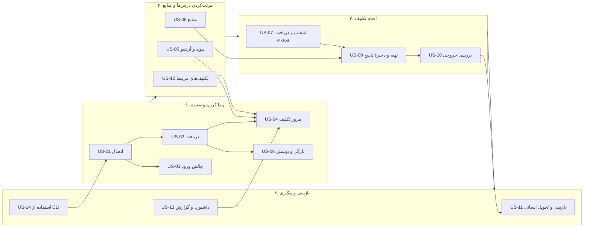
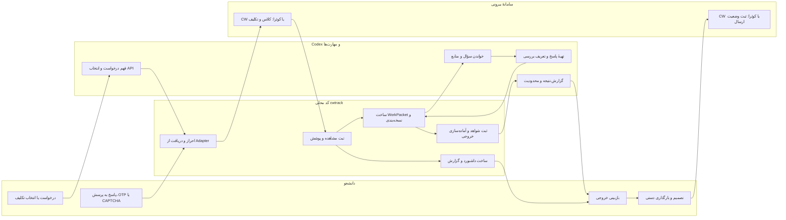
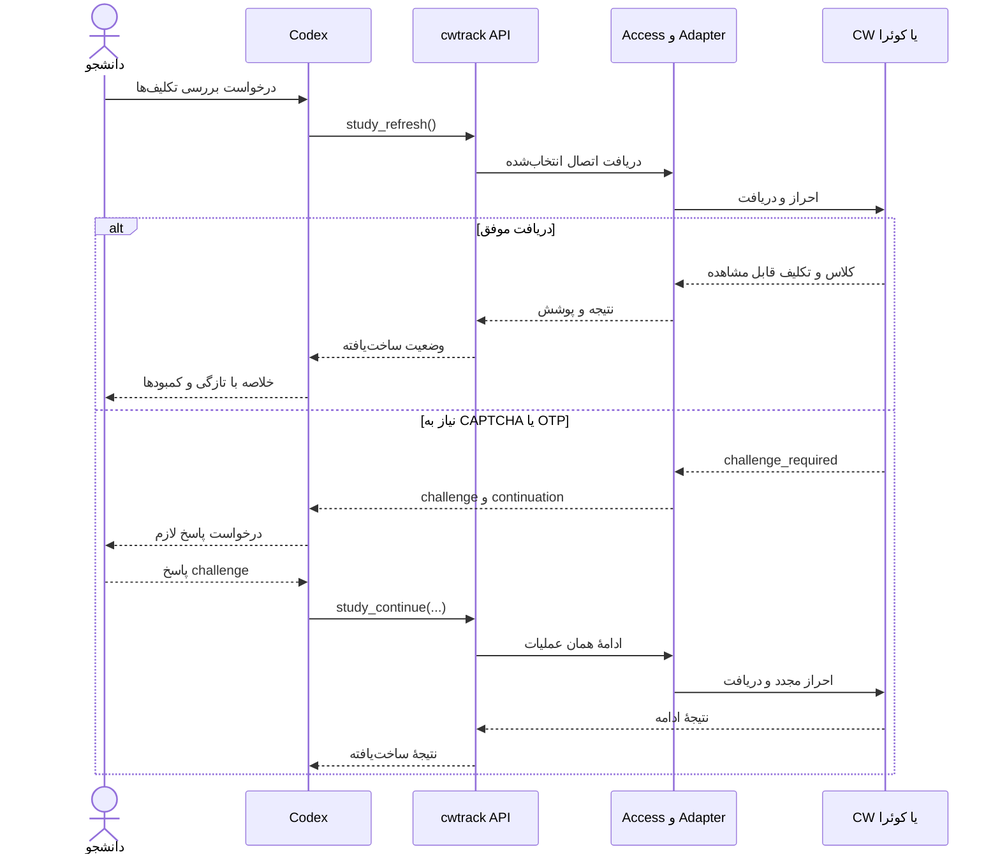
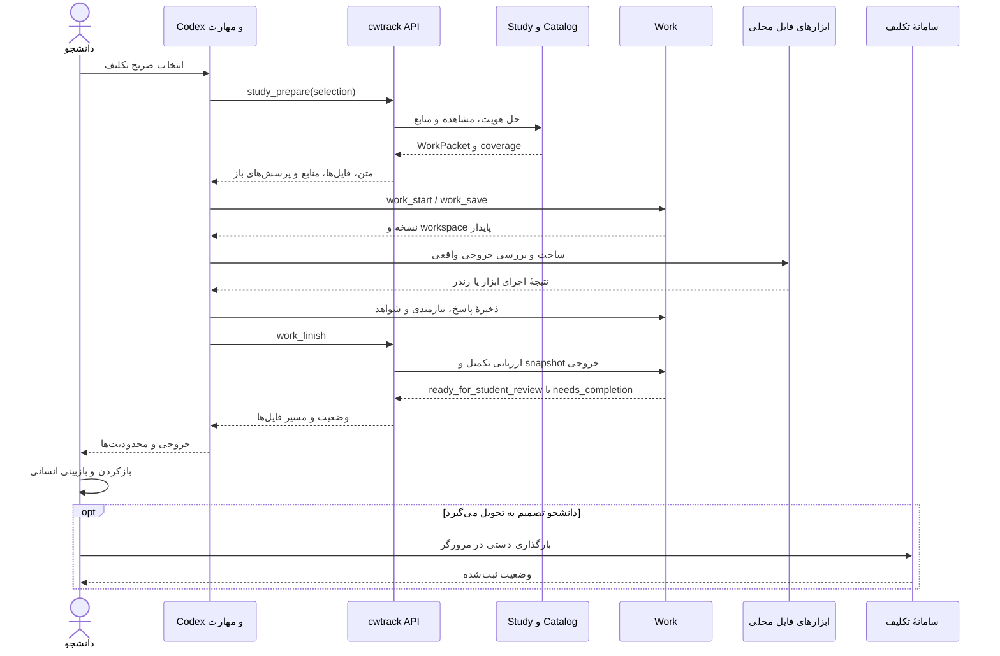

# داستان‌های کاربر و روندهای محصول

این سند مرجعِ رفتار قابل‌مشاهدهٔ `cwtrack` است: کاربر چه هدفی دارد، چه کسی هر مرحله را انجام می‌دهد، مرحله در کجا رخ می‌دهد و نتیجه کجا ذخیره می‌شود. جزئیات Interfaceهای دامنه در سندهای طراحی مرتبط آمده‌اند؛ این سند جای آن‌ها را نمی‌گیرد.

## دامنه و بازیگران

| بازیگر | مسئولیت | محل انجام کار |
|---|---|---|
| دانشجو | انتخاب تکلیف و درس، ارائهٔ اطلاعات یا پاسخ لازم، تعیین نگاشت‌های مبهم، بازبینی و تصمیم نهایی، بارگذاری دستی | گفت‌وگوی Codex، مرورگر سامانه، یا ترمینال محلی |
| Codex و مهارت‌ها | فهم درخواست طبیعی، انتخاب گردش مناسب، پرسیدن اطلاعات واقعاً لازم، خواندن مواد انتخاب‌شده، انجام و بررسی پاسخ، ارائهٔ وضعیت و محدودیت‌ها | گفت‌وگوی Codex؛ مهارت‌ها در `.agents/skills/` |
| بستهٔ `cwtrack` | دریافت و نرمال‌سازی دادهٔ سامانه‌ها، اعمال قواعد دامنه، نگهداری وضعیت محلی و نسخه‌ها، تولید گزارش و داشبورد، ارائهٔ API/CLI | Python محلی از `cwtrack.api` یا فرمان `cwtrack` |
| CW و کوئرا | منبع بیرونی کلاس‌ها، تکلیف‌ها، مهلت‌ها و وضعیت‌هایی که هر سامانه واقعاً منتشر می‌کند | وب‌سایت‌های CW و کوئرا؛ دسترسی فقط از Adapterها |
| ابزارهای محلی | بازکردن، تبدیل یا بررسی فایل‌های خروجی، مانند مرورگر، مفسر کد یا ابزار ساخت PDF | دستگاه دانشجو و پوشهٔ کار |

«هوش مصنوعی» در این معماری به معنی Codex هنگام اجرای درخواست کاربر است. برنامه عامل پس‌زمینه ندارد و به‌تنهایی تکلیف را حل، یادآوری زمان‌بندی‌شده اجرا یا چیزی را در سامانه بارگذاری نمی‌کند.

## نقشهٔ داستان‌ها

این نقشه مسیر اصلی دانشجو را از اتصال داده تا تصمیم تحویل نشان می‌دهد. شناسه‌ها به شرح دقیق داستان‌ها در جدول پایین همین سند وصل هستند.

### تقسیم کار در گردش انتها‌به‌انتها

این نمودار نقش هر بازیگر را در مسیر رایج نشان می‌دهد. جدول‌های WF-01 تا WF-07 پایین‌تر، جزئیات و استثناهای هر گردش را نگه می‌دارند.

## محل ذخیره‌سازی

| داده | محل | مالک معنایی |
|---|---|---|
| مشاهده‌ها و کاتالوگ چندسامانه‌ای | `cw-data/catalog-v2/` | `catalog` و هماهنگ‌کنندهٔ `study` |
| دادهٔ قدیمی CW و dump صفحه‌ها | `cw-data/` و `.cw/` | مسیر سازگاری CW، Adapter و parser |
| کتابخانه و snapshot منابع | زیرمجموعهٔ کاتالوگ داده | `resources` |
| نسخه‌های ورودی، پاسخ و خروجی کار | `work/<work_id>/` | `work` |
| اطلاعات اتصال و رازهای ورود | مخزن محلی محافظت‌شدهٔ کاربر؛ رازها با DPAPI ویندوز | `access` و adapter ذخیرهٔ امن |
| مهارت‌ها و دستورالعمل‌های Codex | `.agents/skills/` | محصولِ دستیار، نه بستهٔ اجرایی پایتون |

مسیر واقعی داده می‌تواند با `--data`، `--home` و `--work` یا آرگومان‌های API تغییر کند. برنامه نباید نبود فروشگاه را به فهرست خالی یا «تکلیفی نیست» تعبیر کند.

## فهرست داستان‌های کاربر

وضعیت قابلیت‌ها در این جدول مربوط به پیاده‌سازی ثبت‌شده در مخزن است. «پیاده» یعنی مسیر کد/آفلاین وجود دارد؛ پذیرش زندهٔ پایدار سامانه را تضمین نمی‌کند.

معیار پایان قابل‌آزمون، شاهد هر آزمون، شکاف‌های فنی و پذیرش زنده برای تک‌تک داستان‌ها در [ماتریس معیار پایان و شکاف‌ها](story-acceptance.md) ثبت می‌شوند. وضعیت باید از روی آن ماتریس خوانده شود؛ برچسب کوتاه به‌تنهایی ادعای تکمیل نیست.

| شناسه | داستان کاربر | معیار نتیجه |
|---|---|---|
| US-01 | به‌عنوان دانشجو می‌خواهم اتصال CW یا کوئرا را تنظیم کنم تا دادهٔ حساب خودم دریافت شود. | اتصال به origin و حساب درست وابسته باشد؛ راز در فایل پروژه یا تاریخچهٔ فرمان ذخیره نشود؛ نبود اعتبارنامه و چالش با وضعیت روشن برگردد. **پیاده؛ محدودیت‌های هر سامانه جداست.** |
| US-02 | به‌عنوان دانشجو می‌خواهم کلاس‌ها و تکلیف‌های تازه را دریافت کنم تا وضعیت محلی من با آخرین مشاهدهٔ موفق قابل‌دسترسی به‌روز شود. | دریافت هر اتصال مستقل باشد؛ موفقیت، ناقص‌بودن، خطا و زمان آخرین موفقیت قابل‌تفکیک بمانند؛ خطای تازه دادهٔ موفق قبلی را پاک نکند. **پیاده؛ پذیرش زندهٔ پایدار CW/کوئرا هنوز کامل تأیید نشده است.** |
| US-03 | به‌عنوان دانشجو می‌خواهم اگر CAPTCHA یا OTP لازم شد بدانم چه چیزی را باید وارد کنم و دریافت را ادامه دهم. | دستیار تصویر/چالش و زمینهٔ عملیات را نشان دهد؛ پاسخ به همان عملیات ادامه یابد و دریافت تازه فقط بعد از احراز موفق انجام شود. **CW پیاده؛ مسیر تعاملی کوئرا محدود/ناقص است.** |
| US-04 | به‌عنوان دانشجو می‌خواهم تکلیف‌های عقب‌افتاده، نزدیک، نامعلوم و تحویل‌شده را ببینم تا برای کار بعدی تصمیم بگیرم. | وضعیت محلی با وضعیت سامانه یکی فرض نشود؛ نامعلوم «تحویل‌نشده» نشود؛ مهلت عادی و اضافه جدا بماند. **پیاده.** |
| US-05 | به‌عنوان دانشجو می‌خواهم کلاس‌های سامانه را به درس نیم‌سال وصل یا جاری/بایگانی/نامشخص کنم تا دادهٔ چند سامانه درست گروه‌بندی شود. | نگاشت صریح باشد؛ کلاس بی‌نگاشت جدا دیده شود؛ چند کلاس پیوندخورده یک درس داشته باشند، اما منشأ هر تکلیف معلوم بماند؛ بایگانی از جاری و نامشخص جدا باشد. **پیاده در کاتالوگ و فرمان `study`.** |
| US-06 | به‌عنوان دانشجو می‌خواهم بدانم دریافت تکلیف یا منابع هر کلاس کامل و تازه بوده یا نه تا «چیزی پیدا نشد» را با «چیزی وجود ندارد» اشتباه نگیرم. | پوشش، زمان و نتیجه به تفکیک سامانه/کلاس باشد؛ ناقص، قدیمی، بدون اتصال و بررسی‌شده معانی جدا داشته باشند. **پیاده با محدودیت‌های مستند Adapter.** |
| US-07 | به‌عنوان دانشجو می‌خواهم تکلیف را دقیق انتخاب کنم و اگر دو سامانه موردی یکسان دارند، با شواهد آن را تشخیص و تأیید کنم تا Codex روی تکلیف اشتباه کار نکند. | `TaskRef`های مشابه از دو سامانه با عنوان، متن، خروجی و پیوست قابل‌خواندن مقایسه شوند؛ تفاوت/کمبود و مهلت/وضعیت هر انتشار نشان داده شود؛ گروه «یکسان» فقط با تأیید دانشجو ثبت شود؛ هر انتشار و Work مستقل بماند. |
| US-08 | به‌عنوان دانشجو می‌خواهم منابع رسمی درس و منابع تکمیلی را ثبت، به درس/تکلیف متصل و نسخهٔ استفاده‌شده را مشخص کنم. | ثبت منبع، دریافت محتوا و استفاده از محتوا سه واقعیت جدا باشند؛ snapshot استفاده‌شده تغییرناپذیر باشد؛ محل و بخش واقعاً استفاده‌شده ثبت شود. **پیاده؛ استخراج محتوای همهٔ قالب‌ها تضمین نیست.** |
| US-09 | به‌عنوان دانشجو می‌خواهم Codex پاسخ تکلیف را با اتکا به صورت سؤال و منابع تهیه کند و در طول کار پیشرفت را حفظ کند. | هر تکلیف چرخهٔ کار و نسخهٔ مستقل داشته باشد؛ پرسش‌های باز و فرض‌ها دیده شوند؛ مواد استفاده‌شده ثبت شوند؛ تغییر ورودی بررسی‌های متأثر را منقضی کند. **پیاده در `work`; کیفیت پاسخ همچنان نیازمند بازبینی است.** |
| US-10 | به‌عنوان دانشجو می‌خواهم خروجی در قالب خواسته‌شده آماده و متناسب با الزام‌ها بررسی شود تا بتوانم آن را بازبینی کنم. | بررسی به نسخهٔ مشخص ورودی و پاسخ متصل شود؛ فایل‌های واقعی با نقش و اثرانگشت ثبت شوند؛ خطا/بررسی‌نشده مانع وضعیت آماده شود. **پیاده در قرارداد `work_finish`; نوع بررسی تابع تکلیف است.** |
| US-11 | به‌عنوان دانشجو می‌خواهم خروجی نهایی و محدودیت‌هایش را ببینم تا خودم دربارهٔ تحویل تصمیم بگیرم. | تحویل سامانه هرگز از آماده‌بودن محلی استنتاج نشود؛ دانشجو فایل را بخواند و خودش در مرورگر بارگذاری کند. **پیاده و مرز ثابت محصول.** |
| US-12 | به‌عنوان دانشجو می‌خواهم تکلیف‌های مرتبط را علامت بزنم تا در مرورشان رابطه را ببینم، بدون ادغام کار و وضعیت تحویل. | رابطه جدا از هویت تکلیف باشد؛ پاسخ، مهلت و ارسال هر تکلیف مستقل بمانند. **پیاده.** |
| US-13 | به‌عنوان دانشجو می‌خواهم نمای داشبورد و گزارش محلی داشته باشم تا دادهٔ ثبت‌شده را سریع مرور کنم. | رندر از مدل خواندن واحد استفاده کند؛ نمایش داشبورد شبکه یا حل تکلیف انجام ندهد؛ خروجی CLI و API دربارهٔ وضعیت اختلاف نداشته باشند. **پیاده؛ بعضی مسیرهای قدیمی هنوز CWمحورند.** |
| US-14 | به‌عنوان دانشجو می‌خواهم مسیرهای CLI را برای اتصال، دریافت، مشاهده و مدیریت درس‌ها اجرا کنم تا بدون گفت‌وگوی Codex هم ابزار را به کار ببرم. | CLI همان API را صدا بزند؛ فرمان تعاملی فقط در لایهٔ CLI باشد؛ داده و رازها امن بمانند. **پیاده؛ مدیریت هنوز میان چند فرمان و مسیر قدیمی تقسیم است.** |

## گردش‌های اصلی و تقسیم مسئولیت

### WF-01 — اتصال و احراز هویت

| گام | مسئول | محل و عملیات |
|---|---|---|
| 1 | دانشجو | درخواست اتصال در Codex یا اجرای `cwtrack connect`؛ نام کاربری/رمز را می‌دهد. |
| 2 | Codex | برای API مقدار لازم را می‌فرستد؛ اگر چالش تعاملی باشد، از دانشجو OTP/CAPTCHA می‌خواهد. |
| 3 | کد | `access` اتصال را ثبت، راز را در vault امن نگه می‌دارد و Adapter احراز هویت همان origin را اجرا می‌کند. |
| 4 | سامانهٔ بیرونی | CW/کوئرا ورود را می‌پذیرد یا خطا/چالش می‌دهد. |
| 5 | کد و Codex | کد وضعیت ساخت‌یافته برمی‌گرداند؛ Codex ادامهٔ لازم را توضیح می‌دهد. |

### WF-02 — تازه‌سازی و مشاهدهٔ وضعیت

| گام | مسئول | محل و عملیات |
|---|---|---|
| 1 | دانشجو | «تکالیفم را بررسی کن» یا `cwtrack fetch` / `api.study_refresh()` را درخواست می‌کند. |
| 2 | Codex | در صورت نیاز، تازگی را می‌سنجد و API را فراخوانی می‌کند؛ پس از نتیجهٔ ساخت‌یافته وضعیت را به زبان روشن خلاصه می‌کند. |
| 3 | کد | Adapterها هر اتصال را مستقل می‌خوانند، parser دادهٔ شناخته‌شده را نرمال می‌کند و `catalog` مشاهده/پوشش/زمان را ثبت می‌کند. |
| 4 | سامانهٔ بیرونی | دادهٔ قابل مشاهده را پاسخ می‌دهد؛ صفحهٔ غیرقابل‌دسترس به معنای نبود داده نیست. |
| 5 | دانشجو | فقط هنگام چالش یا ابهام لازم پاسخ می‌دهد؛ تصمیم می‌گیرد روی کدام تکلیف ادامه دهد. |

### WF-03 — پیوند درس و مدیریت وضعیت کلاس

| گام | مسئول | محل و عملیات |
|---|---|---|
| 1 | دانشجو | کلاس بی‌نگاشت/نامشخص را با اطلاعات ترم بررسی می‌کند. |
| 2 | Codex یا CLI | نام کلاس، سامانه و نامزدها را نشان می‌دهد؛ در ابهام از کاربر تأیید می‌گیرد. |
| 3 | کد | `catalog` پیوند یا وضعیت جاری/بایگانی/نامشخص را با شناسه و بازبینی محلی ذخیره می‌کند؛ تطبیق خودکار فقط در قاعدهٔ دقیق و یکتا مجاز است. |
| 4 | داشبورد | یک کارت درسِ نیم‌سال می‌سازد و تکلیف هر سامانه را با نام سامانه و کلاس نگه می‌دارد؛ کلاس بی‌نگاشت جدا می‌ماند. |

### WF-04 — انتخاب تکلیف و آماده‌کردن زمینهٔ کار

| گام | مسئول | محل و عملیات |
|---|---|---|
| 1 | Codex | اگر عنوان مشابه در چند سامانه هست، `TaskRef` هر نامزد را با `collect_assignment` می‌گیرد و متن، خروجی لازم و پیوست خوانا را مقایسه می‌کند؛ فقط شباهت عنوان را کافی نمی‌داند. |
| 2 | Codex | شواهد یکسان/متفاوت/ناخوانا را نشان می‌دهد؛ مهلت و وضعیت هر انتشار را جدا می‌آورد و از دانشجو می‌پرسد آیا این‌ها یک تکلیف‌اند. |
| 3 | دانشجو | یکسان‌بودن را تأیید یا رد می‌کند؛ در رد/تردید تکلیف‌ها جدا می‌مانند. |
| 4 | کد | پس از تأیید، `assignment_relate(..., relation_type="same_assignment")` را با revision جاری ذخیره می‌کند؛ داشبورد یک گروه نمایشی و کارت جدا برای هر سامانه می‌سازد. |
| 5 | دانشجو و Codex | پس از انتخاب دقیق انتشار، `study_prepare(selection)` را اجرا می‌کنند؛ Work و تحویل برای هر TaskRef مستقل می‌مانند. |
| 6 | کد و دانشجو | ورودی/پیوست پشتیبانی‌شده را دریافت یا کمبودش را می‌گویند؛ دانشجو اطلاعات شخصی/آزمایشگاهی و تصمیم‌های لازم را تکمیل می‌کند. |
| 7 | Codex | فقط پس از خواندن محتوا، بریف و برنامهٔ کار می‌سازد؛ دادهٔ ثبت منبع را جای محتوای خوانده‌شده نمی‌گذارد. |

### WF-05 — انجام، نسخه‌بندی و بررسی پاسخ

| گام | مسئول | محل و عملیات |
|---|---|---|
| 1 | Codex | مسئله را حل می‌کند، فایل‌ها را در workspace محلی می‌سازد، سؤال باز و محدودیت را حفظ می‌کند و `work_save` را فراخوانی می‌کند. |
| 2 | کد | `work` نسخهٔ ورودی/پاسخ، فایل‌ها، منابع استفاده‌شده و شواهد کنترل را نگه می‌دارد؛ تغییر مؤثر fingerprint بررسی قبلی را بی‌اعتبار می‌کند. |
| 3 | ابزار محلی | در صورت نیاز کد را اجرا، سند را رندر، یا PDF/فایل را برای بازرسی باز می‌کند. |
| 4 | Codex | خروجی واقعی را در برابر الزام‌های تعریف‌شده می‌سنجد و نتیجه را با fingerprintها و فایل‌های بررسی‌شده ثبت می‌کند. |
| 5 | دانشجو | اگر داده یا قضاوت شخصی لازم باشد پاسخ می‌دهد؛ خروجی و یادداشت محدودیت را بازبینی می‌کند. |

### WF-06 — بازبینی و تحویل

| گام | مسئول | محل و عملیات |
|---|---|---|
| 1 | کد | `work_finish` فایل‌های ثبت‌شده را به تاریخچهٔ تغییرناپذیر کپی می‌کند و فقط بر اساس الزام/شواهد وضعیت `ready_for_student_review` یا `needs_completion` می‌دهد. |
| 2 | Codex | مسیر خروجی، بررسی‌های انجام‌شده و کار باقی‌مانده را می‌گوید؛ برای وضعیت آماده هم تضمین درستی مطلق نمی‌دهد. |
| 3 | دانشجو | فایل را باز می‌کند، تأیید انسانی می‌دهد، سپس در مرورگر خودش به سامانهٔ مقصد می‌رود و در صورت تصمیم خودش بارگذاری می‌کند. |
| 4 | سامانهٔ بیرونی | پس از اقدام دانشجو وضعیت ارسال/ارزیابی را ثبت می‌کند؛ دریافت بعدی آن وضعیت مستقل از سابقهٔ تولید محلی است. |

### WF-07 — ثبت و استفاده از منابع

| گام | مسئول | محل و عملیات |
|---|---|---|
| 1 | دانشجو یا Codex | منبع را از فایل محلی/صفحهٔ درس انتخاب و به offering یا تکلیف متصل می‌کند. |
| 2 | کد | `resources` منبع، مبدأ، دامنه، نسخهٔ snapshot و پیوند را نگه می‌دارد؛ دریافت ناقص را صریح می‌کند. |
| 3 | Codex | فایل/بخش واقعی را می‌خواند؛ سپس شناسهٔ نسخه و محدودهٔ مورد استفاده را به کار ثبت می‌کند. |
| 4 | داشبورد/API | ثبت منبع، coverage دریافت و استفادهٔ واقعی از منبع را جدا نشان می‌دهد. |

## نمودارهای توالی برای مسئولیت‌ها

این نمودارها رفت‌وبرگشت پیام بین actorها را خلاصه می‌کنند. آن‌ها روندهای مستندشده را نمایش می‌دهند؛ مسیر تعامل با سامانهٔ بیرونی به capability همان Adapter وابسته است.

### دریافت و رفع چالش

### انتخاب، انجام و تحویل انسانی

## رابط‌های استفاده و مسیر کد

| هدف کاربر | مسیر Codex | مسیر CLI / محلی | مالک اصلی کد |
|---|---|---|---|
| مشاهدهٔ تکلیف و تازگی | `api.status`, `api.study_view` | `report`, `gaps`, `open`, `ui` | `study`, `catalog`, Renderer |
| دریافت | `api.study_refresh` یا `api.refresh` قدیمی | `fetch` | `study`, `access`, `platforms`, مسیر قدیمی CW |
| پیوند/آرشیو کلاس | `api.course_link`, `api.class_tracking` | `study` | `catalog` |
| مشاهده/مدیریت منابع | `api.resource_view/attach/capture/detach/update` | `material` برای کتابخانهٔ قدیمی | `resources` |
| شروع/ادامه/ذخیره/پایان پاسخ | `api.study_prepare`, `api.work_*` | بخشی از مسیر قدیمی `brief` | `study`, `work` |
| دریافت سؤال پلتفرم | `api.collect_assignment` و Adapter | `fetch` برای CW | `intake`, `platforms` |

نام عملیات بالا بر اساس API فعلی است؛ ممکن است CLI هنوز برای همهٔ Interfaceهای چندسامانه‌ای سطح دسترسی یکسان نداشته باشد.

## محدودیت‌ها و پرسش‌های باز ثبت‌شده

- پذیرش زنده و پایدار همهٔ Adapterها انجام نشده؛ وضعیت آفلاین یا fixture اثبات‌کنندهٔ دسترسی دائمی نیست.
- ادامهٔ تعاملی CAPTCHA در کوئرا به اندازهٔ مسیر CW کامل نیست.
- جریان‌های قدیمی `brief`, `materials_text`, `tracker.store/load/gaps` هنوز CWمحورند و به‌تدریج باید یا پشت Adapter/Facade بمانند یا جایگزین شوند.
- داشبورد محلی خواندنی است. فرمان مدیریت درس در CLI هست، ولی تمام عملیات تنظیم اتصال/منابع/کار از یک تجربهٔ CLI واحد ارائه نشده‌اند.
- هر capability جدید باید story، مراحل هر actor، قرارداد API، محل داده، رفتار خطا/چالش و معیار پذیرش متناظر داشته باشد.

## پیوند به قراردادهای موجود

- [طراحی چرخه و رابط‌های انجام تکلیف](assignment-work-interfaces.md)
- [طراحی کوئرا، منابع و مطالعه](quera-and-resources-interfaces.md)
- [واژه‌نامهٔ دامنه](../GLOSSARY.md)
- [تصمیم‌های معماری](adr/)
