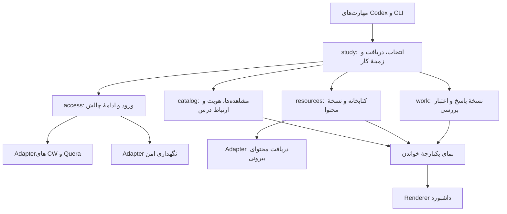

# طراحی Interfaceهای کوئرا و منابع تکمیلی

وضعیت: پیاده‌سازی بخشی از قراردادهای فنی Q16 تا Q32 با آزمون‌های T1 تا T4 انجام شده است. اتصال امن، مشاهده‌های مستقل، گردش کار نسخه‌دار، کتابخانهٔ snapshot منابع و داشبورد مشترک تست آفلاین دارند. فهرست کلاس و تمرین کوئرا از صفحهٔ احرازشدهٔ درس خوانده می‌شود و آزمون fixture دارد؛ پذیرش زنده با حساب انجام نشده است. دریافت متن/پیوست تمرین و ادامهٔ reCAPTCHA تعاملی هنوز شکاف اجرایی‌اند. این سند مرز کد موجود، قرارداد هدف و محدودیت‌هایی را که نباید به‌عنوان پشتیبانی کامل معرفی شوند جدا می‌کند.

واژگان Module، Interface، Implementation، Depth، Seam، Adapter، Leverage و Locality مطابق `codebase-design` هستند. مفاهیم محصول در [واژه‌نامه](../GLOSSARY.md)، تصمیم‌ها در [طراحی محصول](quera-and-course-resources-design.md) و Interface موجود کار در [طراحی انجام تکلیف](assignment-work-interfaces.md) آمده‌اند.

## مسئلهٔ واقعی در کد موجود

| محل | پیچیدگی‌ای که باید یک مالک داشته باشد |
|---|---|
| `tracker.Assignment` و `tracker.store/load/gaps` | هویت عددی CW، نوشتن کل فهرست، گروه‌بندی درس و تعبیر `done`؛ این قرارداد بدون تغییر معنا به کوئرا تعمیم‌پذیر نیست. |
| `api.collect_assignment` و `intake.collect_site` | انتخاب با `cmid` و مسیرهای Moodle؛ دریافت متن، پیوست و ورود مخصوص CW است. |
| `api.refresh`، `auth` و `client` | اطلاعات ورود و چالش، با Client تازه و کوکی حافظه‌ای؛ فایل `session.json` نشست قابل بازیابی نیست. |
| `work.start/sync/save/finish` | هویت `manual/site`، نسخه‌ها، اثرانگشت‌ها و آمادگی؛ این قواعد باید یک چرخهٔ کار باقی بمانند. |
| `materials_text`، `scan_materials` و `brief` | فهرست فایل محلی، بدون ثبت مستقل منبع، محدوده، نسخهٔ محتوا یا وابستگی پاسخ به منبع. |
| `dashboard.build` | باید دادهٔ نرمال‌شده بگیرد؛ تفسیر نمره، ادغام درس، دریافت شبکه یا خواندن layout داخلی به Renderer منتقل نمی‌شود. |

در `api.refresh` فعلی شرط بازگشت پس از ورود، نتیجهٔ غیر `captcha_required` را برمی‌گرداند و در مسیر `captcha_required` به دریافت صفحه می‌رسد. پیش از استفادهٔ دوباره از این مسیر، آزمون رفتاری لازم است که «ورود موفق به دریافت منجر شود» و «چالشِ منتظر پاسخ دریافت احرازشده را شروع نکند». این سند آن کد را اصلاح نکرده است.

## سه شکل Interface بررسی‌شده

### طرح A: یک Module با سه عملیات

```python
coursework.view(query)
coursework.configure(edit, expected_revision=...)
coursework.refresh(targets=..., continuation=...)
```

`work_*` باقی می‌ماند و `view` زمینهٔ درس، سؤال و منابع را یکجا می‌دهد. Leverage برای caller بالاست، اما `edit` باید تغییر درس، منبع، ارتباط تکلیف و اطلاعات ورود را بشناسد. سه تابع، این دانش را حذف نمی‌کند؛ در صورت گسترش، Interface به واژگان فرمان‌های متفاوت وابسته می‌شود و Locality در یک هماهنگ‌کنندهٔ بزرگ کاهش می‌یابد.

### طرح B: Interfaceهای مستقل برای مالکیت‌های صریح

```python
inbox.receive(connection, selection)
courses.link_classes(offering, classes, expected_revision=...)
library.register(spec)
library.bind(resource, target)
work.begin(selection)
```

مالکیت مشاهدهٔ سامانه، ارتباط درس، محتوای منبع و اعتبار کار روشن است. Depth برای استفادهٔ مستقل از هر Module خوب است، ولی caller رایج باید دریافت، ارتباط‌ها، ثبت منبع، انتخاب سؤال و شروع کار را به ترتیب کنار هم بگذارد. یک record کار برای مجموعه و `tasks` داخلی نیز بررسی شد؛ تغییر چرخهٔ فعلی و مهاجرت پاسخ‌ها را پرهزینه‌تر می‌کند.

### طرح C: زمینهٔ آمادهٔ کار برای caller رایج

```python
study_refresh()
study_view()
resource_attach(source, to=...)
study_prepare(selection)
```

انتخاب صریح دانشجو به زمینهٔ ذخیره‌شدهٔ سؤال، کار موجود، منابع مرتبط و تغییرات نیازمند بررسی تبدیل می‌شود. Depth در Seam انتخاب کار بالاست: دو مهارت و داشبورد قواعد اتصال داده را دوباره نمی‌سازند. هزینه، داشتن یک مدل خواندن مشخص برای این محصول است؛ یک زبان پرس‌وجوی عمومی ایجاد نمی‌شود.

| طرح | Depth برای مهارت و داشبورد | Locality | هزینهٔ Interface |
|---|---|---|---|
| A | زیاد، اگر قواعد واقعاً در آن متمرکز شوند | خطر تمرکز همهٔ مسئولیت‌ها در یک Module | تعداد تابع کم، واژگان edit گسترده |
| B | زیاد برای استفادهٔ مستقل | مالکیت روشن و تغییرات متمرکز | caller باید چند عملیات را هماهنگ کند |
| C | زیاد برای مسیر رایج انتخاب و ادامه | خوب، در صورت مالکیت صریح Implementation | چهار عملیات رایج، تنظیمات تخصصی جدا |

**انتخاب: طرح C برای Interface caller، با مالکیت‌های صریح طرح B در Implementation.** طرح A به‌صورت فرمان عمومی `execute/configure` پیاده نمی‌شود. چرخهٔ فعلی `work` حفظ می‌شود؛ هر سؤال انتخاب‌شده یک کار مستقل دارد و مجموعه با گروه ثابتِ همان کارها نمایش داده می‌شود. یک چرخهٔ موازی برای مجموعه ساخته نمی‌شود.

## Moduleها و محل Seamها



| Module | Interface و قواعد متعلق به آن | چیزی که مالک آن نیست |
|---|---|---|
| `study` | انتخاب ثابت، هماهنگی دریافتِ انتخاب‌شده، یافتن کار موجود، ساخت `WorkPacket`، ادامهٔ عملیات معلق و مدل مشترک خواندن | تفسیر HTML، محاسبهٔ hash و حکم علمی دربارهٔ پاسخ |
| `catalog` | هویت چندسامانه‌ای، مشاهده‌های مستقل با پوشش دریافت، ارتباط کلاس و درسِ نیم‌سال، آرشیو، رابطهٔ تکالیف و تازه‌بودن داده | رمز، پاسخ تکلیف و محتوای ادعایی منابع |
| `access` | انتخاب اطلاعات ورود، نشست واقعی، چالشِ همان تلاش، انقضا و صحت دسترسی احرازشده | تحویل پاسخ یا اعلام آماده‌بودن کار |
| `resources` | ثبت و اتصال منبع، محدوده، دسترسی محتوا، snapshot و نسخهٔ مشاهده‌شده | تشخیص معناییِ بخش مرتبط یا ادعای فهمیدن منبع |
| `work` موجود | نسخه و قفل کار، ورودی و استفادهٔ واقعی منابع، الزام‌ها، شواهد جاری، بازبینی و کپی خروجی | ورود، جست‌وجوی وب، حل مستقل یا اجرای مدل |

`study` توابع داخلی را یک‌به‌یک صادر نمی‌کند؛ عملیات رایج آن کار دامنه‌ای کامل انجام می‌دهند. Interface فعلی در `cwtrack.api` Adapter سازگاری برای callerهای موجود است؛ تمام جزئیات شبکه یا فایل در آن انباشته نمی‌شود.

## هویت و مدل مشاهده

شکل‌های زیر قرارداد داده‌اند، نه schema ادعاییِ سایت کوئرا. نام و شکل شناسه‌های واقعی پس از مشاهدهٔ مجاز در Adapter نگاشت می‌شوند.

```python
Connection = {id, platform, origin, verified_account_ref, credential_generation}
ClassRef = {connection_id, class_id}
TaskRef = {class_ref, assignment_id, question_id}  # question_id اختیاری
CourseOffering = {id, title, term, class_refs, revision}
ObservedNode = {ref, kind, parent_ref, title, raw_url, coverage, observed_at}
```

- شناسه‌های بیرونی رشتهٔ opaque هستند؛ عدد یکسان در CW و کوئرا یا دو حساب، هویت یکسان نمی‌سازد. عنوان، شمارهٔ ردیف صفحه و نام فایل شناسه نیستند.
- `Connection` یک حساب تأییدشده در origin مشخص را معرفی می‌کند. تغییر رمز همان حساب، هویت تکلیف را عوض نمی‌کند؛ ورود با حساب دیگر، دادهٔ حساب قبلی را تصاحب نمی‌کند.
- `question_id=None` فقط برای تکلیف واقعاً تفکیک‌نشده قابل انجام است. یک node مجموعهٔ چندسؤالی به سؤال‌های مشاهده‌شده گسترش می‌یابد؛ ساختار نامعلوم، سؤال ساختگی یا مجموعهٔ خالیِ کامل محسوب نمی‌شود.
- `offering_id` محلی از `ClassRef` مستقل است. هر کلاس در یک زمان به حداکثر یک درسِ نیم‌سال وصل می‌شود؛ تغییر ارتباط revision می‌خواهد. یکسان‌بودن نام یا نیم‌سال حدس‌زده‌شده ارتباط ایجاد نمی‌کند.
- ثبت محلیِ آرشیو بر نمایش و انتخاب دریافت اثر دارد؛ نسخهٔ پاسخ و سابقهٔ منبع را حذف نمی‌کند.

سه محور هر تکلیف جدا هستند:

```python
submission = {state, raw_text}
evaluation = {state, score, maximum, raw_text}
deadlines = [{kind, at, raw_text, precision, reported_conditions}]
# پیشرفت محلی از WorkView می‌آید، نه از این مشاهده‌ها.
```

`evaluation.state` شامل `unknown/pending/partial/accepted/full/evaluated` است. نمره بدون مقیاس معلوم یا نشانهٔ صریح پذیرش/کمال، نتیجهٔ کامل نیست. مهلت عادی و اضافه با نقش جدا حفظ می‌شوند؛ عبور از مهلت عادی در فرصت اضافه پنهان نمی‌شود. زمان نرمال‌شده همراه متن اصلی و دقت/ناشناختگی آن نگهداری می‌شود؛ timezone و جریمهٔ نامعلوم ساخته نمی‌شوند.

`bucket` و شمارش `done` قدیمی، projection قرارداد CW هستند. این فیلدها روی کوئرا اعمال نمی‌شوند؛ مدل چندسامانه‌ای تعداد ارسال‌شده، نتیجهٔ کامل و خروجی آمادهٔ بررسی دانشجو را جدا نشان می‌دهد. نامشخص از تفریق کل و باز، کامل حساب نمی‌شود.

## Interface رایج برای مهارت و داشبورد

قرارداد هدف و شکل داده در ادامه آمده‌اند؛ همهٔ شکل‌ها هنوز پیاده نشده‌اند. در کد فعلی `Study` مالک `view` و `refresh` است. `cwtrack.api` همچنین `study_prepare` و `study_continue` را صادر می‌کند، اما بخشی از هماهنگی آن‌ها هنوز در facade است و به context `Study` منتقل نشده است:

```python
Study(paths, *, platforms, protected_state, content_reader, clock)
# عملیات همان context:
# view / refresh / prepare / continue_operation
```

```python
study_view(query=None, *, data=None, home=None, work=None) -> StudyView
study_refresh(platforms=None, *, data=None, home=None, work=None) -> RefreshResult
study_prepare(selection, *, data=None, home=None, work=None) -> WorkPacket
study_continue(continuation_id, response, *, data=None, home=None, work=None) -> OperationResult
```

`query` فقط سه شکل مشخص دارد: نمای کلی، یک درسِ نیم‌سال، یا کار/گروه ذخیره‌شده. این فیلد زبان پرس‌وجو یا محل فرمان نوشتن نیست. وابستگی‌های بیرونی یک‌بار هنگام ساخت context تزریق می‌شوند؛ caller برای هر فراخوانی، مجموعه‌ای از Clientها و vaultها را حمل نمی‌کند. آزمون از همین Interface با Adapterهای آزمون استفاده می‌کند و facade از سازندهٔ پیش‌فرض تولید استفاده می‌کند. `paths` ریشه‌های صریح data/work/home را یک‌بار تثبیت می‌کند؛ خواندن نسخهٔ کار به پیدا‌کردن حدسی کتابخانه در CWD وابسته نمی‌شود. `work` نیز reader مبنای منابع و guard محلی را از همین context دریافت می‌کند؛ برای این وابستگی سراغ `study` یا شبکه نمی‌رود.

### `study_view`

خواندن محلی و بدون تغییر داده است: شبکه، ورود، دریافت منبع، ساخت کار و مهاجرت ضمنی ندارد. خروجی شامل کلاس‌های جاری/آرشیوی/با نیم‌سال نامعلوم، تکالیف و سؤال‌ها، آمار با معنای مشخص، وضعیت هر سامانه، منابع مرتبط و کارهای ذخیره‌شده است. همان projection به Renderer داده می‌شود.

برای کار یا گروه، `WorkPacket` شامل snapshot پاسخ ثبت‌شده، زمینهٔ سؤال، منابع نامزد، نسخه‌های استفاده‌شده، تازگی ورودی و ارزیابی فعلیِ نیاز به بازبینی است. ادامهٔ کار به حافظهٔ گفت‌وگو یا عنوان درس وابسته نیست.

### `study_refresh`

اطلاعات فهرست کلاس‌ها و تکالیف سامانه‌های پیکربندی‌شده را می‌گیرد و برای هر هدف نتیجهٔ جدا می‌دهد. دریافت کامل متن و منابع همهٔ تکالیف انجام نمی‌شود و هیچ کار حلی ایجاد نمی‌شود. انتخاب یک سامانه هم ممکن است.

هر مشاهده `scope` و `coverage` دارد: دریافت کامل فهرست کلاس، دریافت تکالیف یک کلاس و دریافت جزئیات یک سؤال یک چیز نیستند. فقط نتیجهٔ کامل همان scope جایگزین مشاهدهٔ قبلی آن می‌شود. شکست صفحه، parse یا صفحه‌بندی ناقص، مشاهدهٔ خالی معتبر نیست. موفقیت یک کلاس می‌تواند ثبت شود و شکست دیگری آخرین مشاهدهٔ موفق آن را نگه دارد؛ نتیجهٔ کل `partial` و پوشش هر کلاس روشن است.

`last_attempt_at`، `last_success_at` و نتیجهٔ آخرین تلاش برای هر اتصال و scope جدا هستند. ناپدیدشدن از فهرست کامل می‌تواند «دیگر در فهرست نیست» ثبت شود، اما تاریخچه و کار محلی حذف نمی‌شوند.

### `study_prepare`

این فراخوانی پس از انتخاب صریح دانشجو انجام می‌شود و حل نمی‌کند. انتخاب شامل TaskRefهای مشخص یا مجموعه با `questions=all/explicit_ids` است؛ انتخاب دستی موجود نیز به همان چرخه وارد می‌شود.

ترتیب کار متعلق به Implementation است: اعتبارسنجی و ثبت انتخاب ثابت، گسترش مجموعه از مشاهدهٔ معلوم، دریافت متن و پیوستِ انتخاب‌شده، یافتن/ساختن کار هر سؤال، ترکیب زمینهٔ مشترک مجموعه و منابع مرتبط، و برگرداندن packet. انتخاب `all` فقط یک‌بار به اعضای صریح تبدیل می‌شود؛ اگر فهرست هنوز کامل نیست، ابتدا دریافت آن به پایان می‌رسد و سپس اعضا تثبیت می‌شوند. شکست یا چالش، draft انتخاب و مرحلهٔ پیشرفت را حفظ می‌کند.

برای تکلیف موجود، همان UUID بازگردانده می‌شود. ورودی تازهٔ متفاوت به‌عنوان `pending_input` گزارش می‌شود و با `work_sync(..., expected_revision=...)` اعمال می‌شود؛ پاسخ قبلی بی‌صدا عوض نمی‌شود. تغییر صرف مهلت/نمره یا ارتباط محلی درس، بازبینی علمی ایجاد نمی‌کند.

گروه، فهرست ثابتی از UUIDهای کار است و مخزن پاسخ دیگری ندارد. سؤال تازهٔ سامانه عضو گروه قبلی نمی‌شود. نمایش «۲ سؤال انتخاب‌شده آماده، ۱ سؤال دیگر در مجموعه» از «کل مجموعه آماده» جداست؛ حکم کل مجموعه پوشش کامل و بررسی همهٔ سؤال‌های لازم را می‌خواهد.

### `study_continue`

یک پاسخ نوع‌دار `otp/readable_code/interactive_completed` را برای چالش outstanding می‌گیرد. نتیجه متعلق به همان `operation` اولیهٔ `refresh/prepare` است؛ caller مرحلهٔ شبکه، نام کلاس یا درخواست متوقف‌شده را از نو نمی‌سازد و سامانه‌های موفق را دوباره refresh نمی‌کند.

```python
OperationResult = {
    "status": ..., "operation": "refresh" | "prepare",
    "operation_id": ..., "result": ..., "issues": ...,
}
ChallengeView = {
    "continuation_id": ..., "kind": ..., "expires_at": ...,
    "display": ..., "attempt_revision": ...,
}
```

در چالش ردشده، چالش تازه با همان جریان برگردانده می‌شود. token قدیمی، انقضا، تعویض حساب یا پاسخ تکراری نتیجهٔ مشخص می‌دهند و ورود موفق فرض نمی‌شوند. در تکرار درخواست تکمیل‌شده، receipt همان عملیات خوانده می‌شود؛ credential یا OTP دوباره ارسال نمی‌شود. caller پس از پاسخ، موفقیت را از نتیجهٔ دسترسی احرازشده می‌فهمد، نه از جملهٔ «انجام شد» یا HTTP 200.

## تنظیمات و منابع: عملیات مشخص، خارج از مسیر رایج

| Interface | قرارداد اصلی |
|---|---|
| `course_link(class_refs, offering, expected_revision)` | ساخت یا ارتباط صریح با درسِ نیم‌سال؛ کلاسِ متصل به درس دیگر بدون تغییر صریح منتقل نمی‌شود. |
| `class_tracking(class_ref, state, term, expected_revision)` | جاری، آرشیو یا تعیین‌نشده؛ تعیین ترم با دادهٔ صریح و حفظ کار شروع‌شده. |
| `assignment_relate(refs, reason)` | رابطهٔ اعلام‌شده میان تکالیف؛ UUID، شواهد یا وضعیت ارسال مشترک نمی‌شوند. |
| `resource_attach(spec_or_id, to, extent=None, expected_revision=None)` | ثبت یک‌باره و اتصال در یک عملیات معمول؛ با ID موجود فقط اتصال جدید ایجاد/اصلاح می‌شود. |
| `resource_update(id, replacement, expected_revision)` | اصلاح مشخصات/مکان منبع؛ خود منبع را خوانده یا استفاده‌شده اعلام نمی‌کند. |
| `resource_detach(binding_id, expected_revision)` | قطع ارتباط فعال؛ snapshotهای استفاده‌شده و تاریخچه پاک نمی‌شوند. |
| `resource_capture(id, extent, acquired=None)` | دریافت/ثبت محتوای واقعاً در دسترس و کپی immutable آن؛ `acquired` برای artifact حاصل از ابزار Codex است، نه ادعای متن یا لینکِ خوانده‌شده. |
| `access_configure(platform, credentials, retention)` | نگهداری امن یا اطلاعات موقت؛ ورودی حساس در result برگردانده نمی‌شود. |
| `access_forget(connection_id)` | حذف اطلاعات ورود ذخیره‌شده و ابطال ادامه‌های وابسته؛ سوابق تکالیف و پاسخ‌ها باقی می‌مانند. |

این عملیات به‌جای صدور `save_token/add_page/set_hash/mark_read` قواعد دامنه‌ای را یکجا نگه می‌دارند. پارامترهای `data/home/work` مانند قرارداد موجود در facade قابل تعیین‌اند و برای اختصار جدول حذف شده‌اند. همهٔ نوشتن‌های رکورد موجود revision می‌خواهند؛ عملیات جدید request ID تولیدشده برای retry امن receipt دارد.

## منابع: ثبت، دریافت و استفاده سه واقعیت جدا

```python
ResourceSpec = {id, title, location, provenance, revision}
ResourceBinding = {id, resource_id, target, requested_extent, active, revision}
ResourceCapture = {id, resource_id, source_version, artifacts, acquired_extent, provenance}
ResourceUse = {capture_id, part_ids, used_extent, section_ids, requirement_ids, purpose}
```

- `target` درسِ نیم‌سال یا TaskRef است. انتقال به نیم‌سال دیگر اتصال صریح تازه است. نام کتاب به‌تنهایی یک مرجع قابل ثبت است، نه محتوای قابل استفاده.
- `location` فایل، پوشه، صفحهٔ وب، فایل دوردست یا ویدئو است. `extent` صفحه، فصل، بخش، اعضای پوشه یا بازهٔ زمانی را بیان می‌کند. ثبت و اتصال محلی است و دانلود همهٔ محتوا را شروع نمی‌کند.
- منبع محلی در فایل موقت کپی و از همان بایت‌های کپی‌شده hash می‌شود؛ hash و snapshot از دو خواندن ناسازگار مبدأ گرفته نمی‌شوند. capture پوشه فهرست اعضای منتخب و hash آن‌ها را دارد؛ فایل نامرتبط تازه، استفادهٔ قبلی از اعضای دیگر را نامعتبر نمی‌کند.
- برای PDF/Word/اسلاید/تصویر، اصل فایل و در صورت استخراج، artifact متن با ارجاع صفحات/بخش‌ها حفظ می‌شوند. ابزار استخراج در Codex است. متن استخراج‌نشده `needs_extraction` است و با مسیر فایل خوانده‌شده فرض نمی‌شود.
- برای وب، محتوای بازیابی‌شده همراه origin و زمان دریافت ثبت می‌شود. برای ویدئو فقط محتوای واقعاً دریافت‌شده، مانند بخش ویدئو یا transcript در بازهٔ زمانی مشخص، قابل ثبت است؛ خواندن transcript به‌عنوان تماشای کل ویدئو معرفی نمی‌شود.
- وضعیت capture یکی از `captured/partial/reference_only/unavailable/needs_extraction` است. ثبت بخشی از منبع، خواندن یا استفادهٔ آن توسط Codex را اثبات نمی‌کند.
- پس از خواندن، `ResourceUse` با `work_save` به بخش پاسخ و الزام مشخص وصل می‌شود. Module وجود artifact، hash، شمول محدوده و معتبر بودن ارجاع را کنترل می‌کند؛ فهم معنایی یا صحت استناد بر عهدهٔ دستیار و بررسی ثبت‌شده است.
- محدودیت منبع در صورت تکلیف مقدم است. نامزدها با ترتیب منابع رسمی درس، منابع تکمیلی مرتبط و سپس کمبود برای جست‌وجوی مجاز عرضه می‌شوند. محدودیت بررسی‌نشده به «همهٔ منابع مجازند» تبدیل نمی‌شود.
- صرف قرارداشتن فایل در پوشهٔ قدیمی `materials` رسمی‌بودن آن را ثابت نمی‌کند؛ منشأ legacy به‌صورت ناشناخته/محلی حفظ می‌شود تا شواهد استاد یا معرفی دانشجو نقش آن را روشن کند.
- منبعی که از origin دیگری محتوا می‌گیرد، اطلاعات ورود CW/کوئرا را دریافت نمی‌کند. نبود دسترسی به لینک خصوصی با `access_required/unavailable` یا artifact تأمین‌شده حل می‌شود؛ یک اتصال ورود عمومی به هر وب‌سایت ساخته نمی‌شود.

## ادامهٔ ورود واقعاً stateful است

`access` باید حساب، کوکی/CSRF یا context واقعی مرورگر، مرحلهٔ چالش، انقضا، نسل اطلاعات ورود و عملیات در انتظار را پشت Seam نگه دارد. continuation یک UUID opaque است؛ ذخیرهٔ صرف «کاربر وارد شد» یا ساخت Client تازه، این قرارداد را برآورده نمی‌کند.

اطلاعات ورود و context حساس در نگهداری محافظت‌شدهٔ سیستم‌عامل قرار می‌گیرند، نه JSON کار، dump، خروجی یا داشبورد. اطلاعات موقت می‌تواند بدون ذخیرهٔ گذرواژه استفاده شود؛ برای ادامه در پردازش تازه، context چالش همچنان باید قابل نگهداری محافظت‌شده باشد. در نبود نگهداری امن، `secure_store_unavailable/continuation_unavailable` گزارش می‌شود و downgrade به فایل رمز ساده انجام نمی‌شود.

Adapter سامانه مالک تفاوت ورود CW و کوئراست. مسیر رمز و سپس چالش احتمالی کوئرا باید با نشست واقعی ادامه یابد. در حالت تعاملی، caller فقط همان مرحلهٔ واقعی را نشان می‌دهد؛ core ورودی تعاملی نمی‌خواند، چیزی چاپ نمی‌کند و پنجرهٔ قابل مشاهده باز نمی‌کند. `interactive_completed` فقط علامت بررسی دوبارهٔ همان context است، نه توکن ساختگی یا اثبات ورود.

خواندن خودکار فقط برای کدِ واقعاً قابل خواندن اجرا می‌شود؛ reCAPTCHA به OCR عمومی تبدیل نمی‌شود. Adapter باید پاسخ چالش، تغییر چالش و محدودیت تلاش را تشخیص دهد؛ خطای ورود کورکورانه تکرار نمی‌شود. ابزار OCR فعلی CW بدون آزمون و سنجش به کوئرا تعمیم داده نمی‌شود.

## گسترش Interface کار و اعتبار شواهد

`work_start/get/save/sync/finish/list/group_start/group_get` باقی می‌مانند. دریافت جدید، `origin_ref` و زمینهٔ مشترک مجموعه را به ورودی می‌افزاید؛ شروع تکراری همان سؤال، همان UUID را برمی‌گرداند. کار دستی با منشأ دستی همچنان معتبر است.

برای نسخه‌های جدید:

```python
VerificationBasis = {
    "scheme": "v2",
    "input_digest": ...,       # صورت، متن مشترک، پیوست و الزام مؤثر
    "answer_digest": ...,
    "requirements_digest": ...,
    "resource_basis_digest": ...,
}
```

`work_save` از artifactهای معتبر و استفاده‌های ثبت‌شده، مبنای بررسی را محاسبه و برمی‌گرداند. شواهد هر الزام، مبنای همان بخش/الزام، روش و نقش/hash فایل واقعی را دارد؛ caller hash قواعد اعتبار را خودش نمی‌سازد. همهٔ نامزدهای کتابخانه وارد مبنا نمی‌شوند؛ فقط استفاده‌های واقعی و محدودیت‌های مؤثر وارد می‌شوند. تغییر label، مهلت، URL نمایشی، نمره یا ارتباط درس محلی، مبنای علمی را عوض نمی‌کند.

`VerificationBasis` بالا خلاصهٔ کل کار است. مبنای هر بررسی projection همان الزام، بخش‌های اعلام‌شدهٔ پاسخ و استفاده‌های متصل به آن‌هاست و از نتیجهٔ `work_save` گرفته می‌شود. اگر ارتباط بخش/الزام کافی نباشد، مبنای کل کار استفاده می‌شود؛ از نبودن نگاشت، بی‌اثر بودن تغییر نتیجه گرفته نمی‌شود. مقایسهٔ `ResourceHead` بر نسخهٔ محتوا و محدودهٔ وابسته است، نه صرف تغییر عنوان یا revision ثبت منبع.

تغییر منبع استفاده‌شده در `ResourceHead` مشاهده‌شدهٔ محلی ثبت می‌شود. `WorkView` فعلی، snapshot پاسخ را با این مشاهده‌ها ترکیب و نیاز به بازبینی را محاسبه می‌کند؛ خواندن، snapshot تاریخی تازه نمی‌سازد. برای تغییر منبع نامعلوم، تمام وابستگی‌های آن منبع در همان کار نامزد بازبینی‌اند؛ افزودن منبع استفاده‌نشده یا تغییر قسمت نامرتبطِ اثبات‌شده، همهٔ کارها را نامعتبر نمی‌کند.

رفع بازبینی با پاک‌کردن یک bool ممکن نیست: ثبتِ مستدل «بی‌اثر» بر مبنای دو نسخه یا به‌روزرسانی پاسخ/استفاده و بررسی‌های جاری لازم است. نبود اطلاعات کافی برای تعیین بخش متأثر، دامنهٔ بازبینی را به کل کار وابسته گسترش می‌دهد.

`work_finish` فقط به `WorkView` قبلی یا `needs_reassessment` ذخیره‌شده اعتماد نمی‌کند؛ مبنای جاری، headهای مشاهده‌شده، الزام‌ها، سؤال‌های باز و hash خروجی‌ها را درست پیش از commit دوباره می‌سنجد. نسخهٔ تاریخی آماده حفظ می‌شود، ولی نمای فعلیِ دارای بازبینیِ حل‌نشده، مؤثر و آماده نمایش داده نمی‌شود. نداشتن دریافت تازه از منبع با مشاهدهٔ تغییر یکی نیست؛ تازگی نامعلوم در یادداشت تحویل می‌آید.

اگر قالب تکلیف یک خروجی مشترک برای چند سؤال لازم داشت، artifact مشترک با همان hash در بررسی سؤال‌های مربوط استفاده می‌شود؛ شواهد مشترک علاوه بر مبنای هر سؤال، digest عضویت انتخاب ثابت و مبنای پاسخ اعضای مرتبط را دارند. تغییر پاسخ یکی از اعضای مرتبط، بررسی بستهٔ مشترک را قدیمی می‌کند. گروه مخزن پاسخ/حل موازی ندارد و آماده‌بودن انتخاب محدود با آماده‌بودن کل مجموعه یکی نیست.

## اتمی‌بودن، رقابت و خطاها

شبکه، استخراج و کپی محتوای حجیم پیش از قفل کوتاهِ commit انجام می‌شوند. انتشار manifestهای محلی، تغییر head منبع و ثبت آمادگی با قفل مشترک metadata در context همین workspace و بررسی revision/نسل وابستگی هماهنگ می‌شوند. این helper جزو Implementation فایل محلی است، نه Interface عمومی Repository. عملیات از ترتیب قفل واحد استفاده می‌کنند و هنگام نگهداری قفل به شبکه نمی‌روند.

`work_finish` زیر همان guard، آخرین نسل وابستگی را می‌خواند و نسخهٔ نهایی را commit می‌کند؛ تغییر منبع در فاصلهٔ بررسی و ثبت، `conflict/needs_reassessment` می‌دهد. این طراحی event bus، اصلاح آبشاری تمام فایل‌های work یا transaction میان سامانه‌های بیرونی لازم ندارد.

هر snapshot محتوا immutable است؛ manifest موقت و انتشار اتمی باعث می‌شود نوشتن نیمه‌تمام، آخرین ثبت معتبر را جایگزین نکند. فایل staging ممکن است پس از وقفه یتیم بماند و بعداً پاک‌سازی شود؛ حذف خودکار artifact استفاده‌شده در دامنه نیست.

نتیجهٔ قابل انتظار با `status` بازگردانده می‌شود: `ok/exists/partial/needs_input/needs_credentials/challenge_required/challenge_expired/challenge_rejected/account_mismatch/unavailable/not_found/invalid_input/conflict/busy`. `stage` فقط مرحلهٔ کار است. خطای I/O یا خرابی دادهٔ محلی با `CwError` و زمینهٔ فاقد secret گزارش می‌شود و نتیجهٔ خالی نیست. ناموفق‌بودن بازسازی داشبورد پس از commit، هشدار جداست؛ caller برای رندر دوباره کار را ثبت نمی‌کند.

## وابستگی‌ها و Adapterهای واقعی

| وابستگی | دسته | Seam و آزمون |
|---|---|---|
| هویت، تقدم منابع، انتخاب، مرتب‌سازی و اعتبار بررسی | In-process | داخل Module مالک، آزمون از Interface؛ port اضافی ندارد. |
| JSON، فایل محتوا، قفل و snapshot | Local-substitutable | filesystem واقعی در پوشهٔ موقت و ادامه در subprocess؛ mock filesystem و Repository عمومی ایجاد نمی‌شود. |
| CW و کوئرا | True external | `PlatformAdapter` واقعی برای هرکدام و Adapter آزمون با پاسخ/چالش پاک‌شده؛ کدِ شکل صفحه و ورود در Adapter می‌ماند. |
| نگهداری امن اطلاعات ورود/context | True external | Adapter سیستم‌عامل و Adapter آزمون؛ فایل JSON ساده Adapter امن محسوب نمی‌شود. |
| محتوای دوردست | True external | Reader واقعی و Reader پاسخ ضبط‌شده؛ فایل/پوشهٔ محلی مستقیماً خوانده می‌شود. |
| استخراج سند، حل، تولید فایل و بررسی علمی | ابزارهای Codex | دستیار اجرا و شواهد را ثبت می‌کند؛ Interface موتور LLM یا solver فرضی افزوده نمی‌شود. |

`PlatformAdapter` داخلی فقط `observe(request, context)` و `resume(private_state, response)` را با سه نتیجهٔ مشخص مشاهده/چالش/شکست عرضه می‌کند. generic HTTP abstraction صرفاً به علت استفادهٔ دو سایت از HTTP ایجاد نمی‌شود. ظرفیت نگهداری context و روش ادامهٔ مرورگر/HTTP، تعهد همان Adapter است؛ در پذیرش زنده باید اثبات شود.

هستهٔ آفلاین با stdlib و مسیرهای فعلی قابل استفاده می‌ماند. نیازهای runtime واقعی Quera و vault در Implementation اختیاری و صریح‌اند؛ نبود runtime نتیجهٔ `adapter_unavailable` دارد. انتخاب ابزار این Adapterها، جایگزین اثبات اتصال زنده نیست و مسیر ثابت داخلیِ یک bundle عمومی و پایدار فرض نمی‌شود.

## ذخیره‌سازی و سازگاری

فایل محلی حفظ می‌شود؛ پایگاه داده، صف، crawler دائمی یا فرایند حل پس‌زمینه اضافه نمی‌شود. طرح layout زیر جزئیات Implementation است و آزمون Interface به آن وابسته نیست:

```text
cw-data/
  user.json, assignments.json, courses/...      # سازگاری CW موجود
  catalog-v2/
    connections/.../observations/...            # پارتیشن مستقل هر اتصال و scope
    offerings/...                               # ارتباط‌های صریح
    resource-library/...                        # ثبت و binding
    resource-captures/...                       # manifest و محتوا
    migrations/...                              # receipt و نگاشت سازگار
work/<existing-work-id>/versions/...             # شناسه و سابقهٔ موجود
.cw/access/...                                  # فقط metadata غیرحساس؛ context حساس محافظت‌شده
```

پارتیشن موفق جدید می‌تواند در یک commit مستقل منتشر شود؛ refresh CW هیچ فهرست Quera را جایگزین نمی‌کند. شناسهٔ دوردست مستقیماً نام مسیر فایل نیست؛ Implementation کدگذاری/شناسهٔ محلی امن را مالک است. مسیرهای داخل manifestها نسبت به ریشه ذخیره و در view به مسیر مطلق تبدیل می‌شوند.

### مسیر سازگار، بدون بازنویسی تاریخچه

1. خواندن legacy بدون نوشتن، دادهٔ CW را به نمای نرمال‌شده می‌برد. `source=site` و `course_id/cmid` فقط CW هستند؛ انتخاب عددی قدیمی هرگز روی همهٔ سامانه‌ها جست‌وجو نمی‌کند.
2. نگاشت اتصال legacy از هویت حسابِ واقعاً ذخیره‌شده/تأییدشده ساخته می‌شود. نبود هویت کافی با وضعیت legacy نامشخص نمایش داده می‌شود؛ حساب واردشدهٔ تازه بدون اثبات همان‌بودن، مالک دادهٔ قبلی نمی‌شود.
3. اولین نوشتن v2، manifest نسخه و receipt مهاجرت idempotent را کنار دادهٔ اصلی ثبت می‌کند. فایل‌های CW، UUIDها، گروه‌ها، شمارهٔ نسخه، مسیر پیوست و تحویل اصلی حفظ می‌شوند. شکست مهاجرت، دادهٔ منبع را تغییر نمی‌دهد.
4. `work_get(revision=n)` همان سابقهٔ اصلی را می‌خواند. alias هویت در نمای خواندن یا نگاشت کنار آن اعمال می‌شود، نه با بازنویسی snapshot.
5. شواهد و fingerprint قدیمی با `scheme=v1` و همان الگوریتم حفظ می‌شوند. صرف نگاشت هویت یا اضافه‌کردن کتابخانه، همهٔ کارهای قدیمی را نیازمند تکمیل نمی‌کند و از دفتر `sources` قدیمی نسخهٔ منبع ساختگی ساخته نمی‌شود.
6. کار تازه یا تغییر معناییِ ورودی/پاسخ/استفادهٔ منبع در ادامهٔ کار، checkpoint با مبنای v2 می‌سازد و شواهد جدید می‌خواهد. تغییر صرف metadata، مبنای v1 معتبر را به‌اجبار عوض نمی‌کند.
7. `api.refresh/status/outstanding/materials_text/collect_assignment({site: ...})` و `work_*` موجود ورودی و معنای خروجی CW خود را حفظ می‌کنند. مهارت و داشبورد چندسامانه‌ای به Interface `study` منتقل می‌شوند؛ `make_brief` قدیمی باقی می‌ماند. سازگاری یک مسیر جدا با منطق دامنهٔ تکراری نیست، projection از Implementation مشترک است.
8. فایل‌های جدید در پوشهٔ قدیمی materials همچنان دیده می‌شوند. ثبت legacy منبع، هویت پایدارِ مستقل از hash محتوا و مرتبط با ClassRef/مسیر نسبی می‌گیرد؛ مشاهده یا import، سابقهٔ استفاده ایجاد نمی‌کند.

این دو تصمیم فنی در [مشاهده‌های مستقل](adr/0007-independent-platform-observations.md) و [حفظ مبنای بررسی legacy](adr/0008-versioned-verification-basis.md) ثبت شده‌اند.

## نمونهٔ caller رایج

نمونهٔ مسیرهای پیاده‌شده (فهرست تمرین Quera دریافت می‌شود؛ جزئیات سؤال هنوز ناقص است):

```python
result = api.study_refresh(platforms=["cw", "quera"])
for action in result["actions"]:
    # caller فقط ورودی نوع‌دارِ همان چالش را می‌گیرد.
    continued = api.study_continue(action["continuation_id"], typed_response)

desk = api.study_view()
attached = api.resource_attach(book_spec, to={"offering_id": chosen_offering})
packet = api.study_prepare(explicit_selection)

# در یک پردازش بعدی، بدون دریافت شبکه یا بازانتخاب:
packet = api.study_view({"group_id": packet["group_id"]})
capture = api.resource_capture(chosen_resource_id, extent=chosen_pages)
# Codex محتوا را واقعاً می‌خواند، حل و فایل تولید می‌کند.
saved = api.work_save(work_id, progress_with_actual_uses,
                      expected_revision=known_revision)
# بررسی‌ها به مبنای برگشتی و فایل‌های واقعی وصل و ذخیره می‌شوند.
finished = api.work_finish(work_id, delivery, expected_revision=checked_revision)
```

هر هدف refresh می‌تواند وضعیت متفاوتی داشته باشد؛ نتیجهٔ مشترک، `targets` و `actions` دارد و وجود چالش میان چند هدف می‌تواند با `status=partial` همراه باشد. caller نتایج موفق/ناموفق سایر سامانه‌ها را نیز می‌بیند و صرف status سطح بالا را معیار نبود چالش نمی‌گیرد. رمز، کوکی و OTP در `desk/packet/result` منعکس نمی‌شوند.

## برش‌های TDD و وضعیت اجرا

مطابق مهارت `tdd`، کاربر مرزهای T1 تا T4 را تأیید کرد. پیاده‌سازی و آزمون‌های آفلاین انجام شدند؛ تست آفلاین وضعیت Adapter را ثابت می‌کند، نه سازگاری سایت زنده.

| Seam پیشنهادی | چه چیزی را می‌گیرد | چه چیزی را ثابت نمی‌کند |
|---|---|---|
| T1: Interface `Study` و facade سازگار | هویت، پوشش و تازگی، دریافت مستقل، انتخاب/ادامه و عدم حذف legacy با filesystem موقت و Adapter بیرونی | سازگاری جاری سایت زنده یا کیفیت علمی پاسخ |
| T2: Interface `resources` همراه `work_*` | artifact واقعی، محدوده و استفاده، نسخه‌ها، اعتبار بررسی، بازبینی و رقابت در finish | فهم منبع یا صحت معنایی استناد توسط مدل |
| T3: Interface قرارداد Adapterهای بیرونی | مشاهده/ادامهٔ CW و Quera با پاسخ‌های پاک‌شده، context، خطاهای نشست و رفتار Adapter نگهداری امن؛ تست از Interface خود Adapter عبور می‌کند | ورود واقعی و همهٔ حالت‌های سمت سرور؛ parser خصوصی سطح تست جدا نمی‌گیرد |
| T4: `build_dashboard` روی view مشترک | نمایش وضعیت/تازگی/منابع و خروجی، همراه بازبینی تصویر در اندازه‌های مناسب | تمام حالات UI یا تازگی واقعیِ دادهٔ دریافت‌نشده |

وضعیت: T1 تا T4 در نسخهٔ فعلی پیاده‌سازی و آزمون آفلاین دارند. T1 هنوز با قرارداد هدف فاصله دارد چون `Study.prepare/continue_operation` در Module پیاده نشده‌اند؛ همین عملیات از facade در دسترس‌اند. Adapter فقط origin رسمی HTTPS هر پلتفرم را می‌پذیرد، و چرخش رمز همان نام کاربری را الزام می‌کند تا هویت اتصال به حساب دیگری منتقل نشود. بازبینی بصری دستی در چند اندازه و پذیرش زنده هنوز انجام نشده است.

هر برش یک رفتار end-to-end از Interface را با آزمون قرمز، حداقل Implementation و سبز تکمیل می‌کند. refactor به مرحلهٔ بازبینی بعدی تعلق دارد و با گسترش پیش‌دستانهٔ چرخهٔ قرمز/سبز مخلوط نمی‌شود. مجموعه‌ای از تست‌های آینده قبل از Implementation همهٔ رفتارها نوشته نمی‌شود.

| برش | نخستین رفتار قابل مشاهده و آزمون لازم | تصمیم‌ها |
|---|---|---|
| S0: سازگاری و ورود CW | fixture قدیمی از همان Interface خوانده و همان UUID/شواهد برگردد؛ ورود موفق دریافت را ادامه دهد و چالش قبل از دریافت متوقف شود. | حفظ قرارداد موجود، Q28 |
| S1: مشاهدهٔ چندسامانه‌ای | ID برابر دو سامانه تداخل نکند؛ موفقیت یکی و شکست دیگری آخرین داده‌ها را حفظ کند؛ فهرست خالی معتبر از parse ناموفق/پوشش ناقص جدا باشد. | Q16، Q29 |
| S2: ورود و ادامهٔ واقعی | Adapter آزمون stateful، OTP/کپچا و ادامه در subprocess؛ انقضا/رد/تکرار، تغییر اطلاعات ورود، vault unavailable و نبود secret در خروجی. | Q28، Q30 تا Q32 |
| S3: درس و حقایق سایت | ارتباط صریح کلاس‌ها، ترم نامعلوم، آرشیو با کار باز؛ سه محور وضعیت، نمرهٔ ناقص/مقیاس نامعلوم و دو مهلت. | Q19، Q21، Q24، Q25 |
| S4: انتخاب و ادامهٔ کار | مجموعه و سؤال منتخب؛ عضویت ثابت پس از وقفه/سؤال جدید؛ شروع تکراری همان UUID و پروندهٔ مستقل تکالیف مرتبط با کنترل مجدد خروجی مشترک. | Q20، Q26 |
| S5: کتابخانه و محتوای واقعی | ثبت و اتصال یک‌باره، استفادهٔ مجدد در ترم تازه، detach بدون حذف تاریخچه، فایل/پوشه/وب/ویدئو با محتوای ناموجود یا محدودهٔ ناقص. | Q17، Q27 |
| S6: منبع و اعتبار بررسی | دریافت با استفاده یکی نشود؛ محدوده و تقدم رعایت شوند؛ تغییر منبع استفاده‌شده در برابر افزودن استفاده‌نشده؛ snapshot تاریخی، رفع مستدل بازبینی و تغییر هم‌زمان منبع هنگام finish. | Q18، Q22، Q23 |
| S7: مهارت و داشبورد | هر دو یک view را مصرف کنند؛ تازگی/نامشخص/نمرهٔ ناقص و منابع/بخش‌های استفاده‌شده درست دیده شوند؛ شکست رندر ثبت کار را تکرار نکند. | Q16 تا Q32 و Q3/Q14 قبلی |
| S8: پذیرش زنده | حساب مجاز: ورود خودکار، سؤال و پیوست واقعی، ادامهٔ OTP/چالش در صورت وقوع، انقضای نشست و یک کار منتخب با خروجی و منبع نسخه‌دار. | تأیید واقعی اتصال و گردش |

آزمون‌ها از Interface مشترک caller، filesystem موقت واقعی و Adapter بیرونی استفاده می‌کنند. برای pure ruleها mock ساخته نمی‌شود. تست‌های فعلیِ رفتار سازگار حفظ می‌شوند؛ وقتی پوشش جدید دقیقاً جای آزمون خصوصیِ منطق منتقل‌شده را گرفت، آن آزمون تکراری جایگزین می‌شود و روی آن لایهٔ تست مشابه افزوده نمی‌شود.

موفقیت تست‌های آفلاین اثبات سازگاری واقعی سایت نیست. S8 به اطلاعات ورود و دسترسی مجاز نیاز دارد؛ در نبود آن، وضعیت تحویل «آزموده‌شده با Adapter، تأیید زنده انجام نشده» صریح می‌ماند. دادهٔ حساب و پاسخ زنده به fixture مخزن تبدیل نمی‌شوند مگر پس از حذف مشخصات و secretها.

## جای‌گذاری فایل‌ها و آزمون حذف

`study.py` هماهنگی و projection، `catalog.py` مشاهده و ارتباط‌ها، `resources.py` کتابخانه و capture، و `access.py` context محافظت‌شده را مالک می‌شوند. کد `auth/client/fetch/parse/intake` فعلی در Implementation Adapter CW قابل استفاده می‌ماند و بعد از پوشش رفتاری به محل مناسب منتقل می‌شود؛ انتقال فایلِ گسترده پیش‌نیاز اولین برش نیست. `work.py` با همان چرخه گسترش می‌یابد و `api.py` Adapter caller موجود باقی می‌ماند. Adapterهای واقعی می‌توانند در `platforms/cw.py` و `platforms/quera.py` قرار بگیرند؛ پوشه صرفاً وقتی اولین Implementation آن ساخته شد ایجاد می‌شود.

اگر `study` حذف شود، تثبیت انتخاب و ترکیب داده در مهارت و داشبورد تکرار می‌شود. حذف `catalog` قواعد هویت و پوشش دریافت را پخش می‌کند. حذف `resources` snapshot و provenance را به caller تحمیل می‌کند. حذف `access` context چالش را بین callerها تکرار می‌کند. حذف `work` همچنان قواعد نسخه، شواهد و آمادگی را پراکنده می‌کند. هر Module پیچیدگی واقعی را در محل مشخص نگه می‌دارد؛ helper صرفاً عبوردهنده نام و Interface مستقل تازه نمی‌گیرد.
